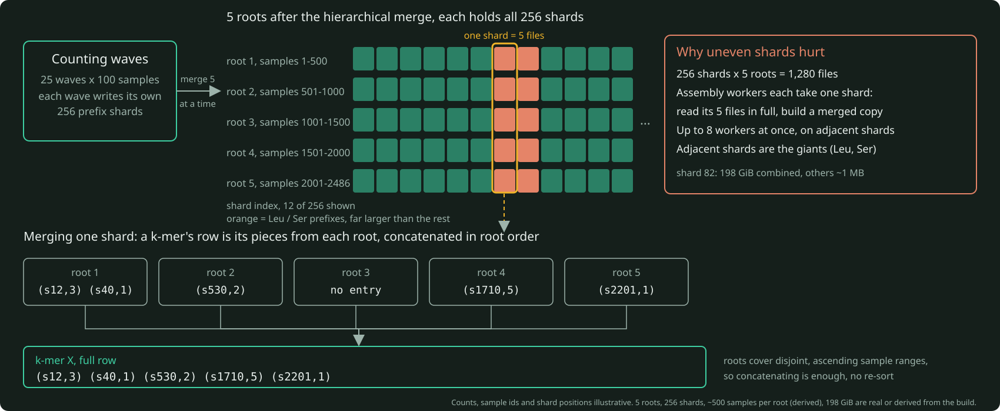
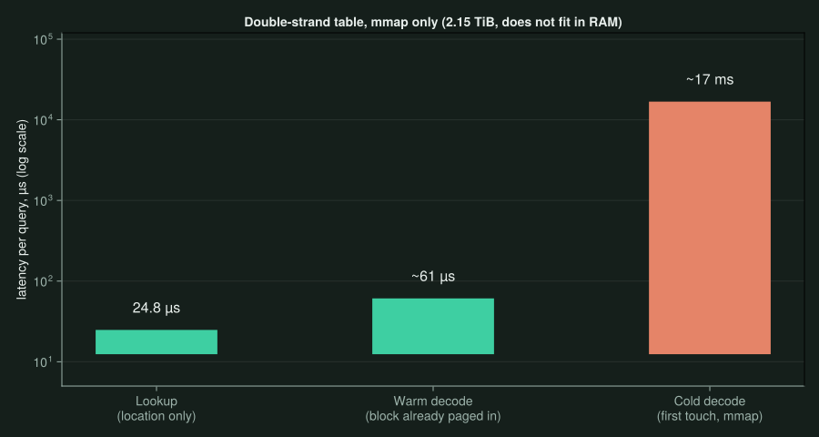
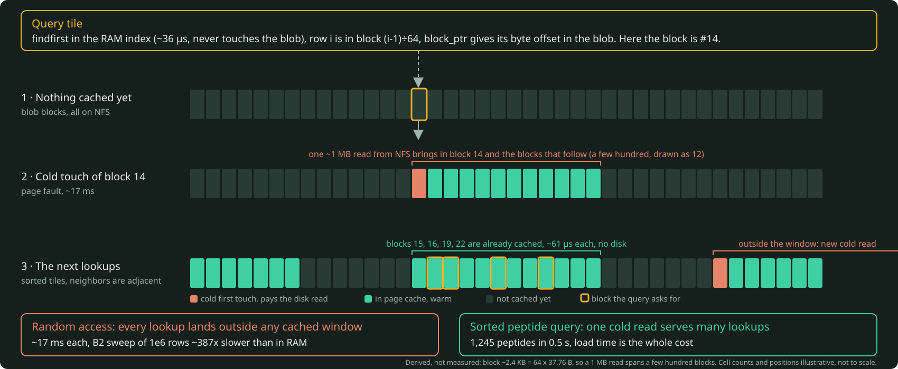
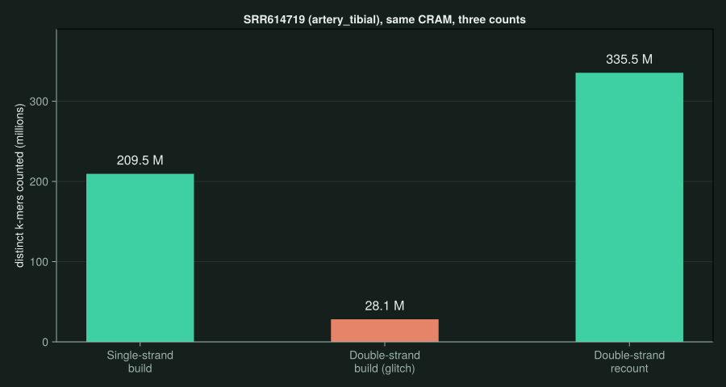
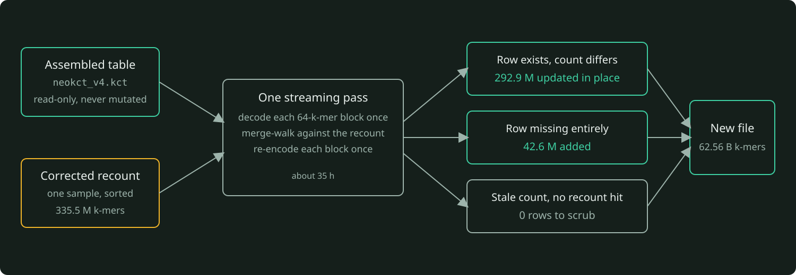

# NeoKCT {background-color="#1a1a2e"}

November 2026

---

## The Analysis Plan · A / B / C {#plan}

Three groups of tasks behind every number in this deck, tracked in `PAPER_TODO.md`:

- **A · Code prerequisites.** Library code needed before any analysis can run: progress logging, peptide query code, the reference index.
- **B · Table and performance numbers.** Engineering numbers for the paper: exact table statistics, query speed, build cost, the REINDEER benchmark.
- **C · Biology.** The analyses that carry the paper's claims, from the peptide sets through the tumor cohort.

| ID | Status |
|---|---|
| A | done |
| B | done, 1 item partial (scaling series) |
| C | done, 2 items partial (C0, C8) |

Each group breaks out into individual tasks, in the appendix: [→ A0-A5](#appendix-a), [→ B1-B4](#appendix-b), [→ C0-C9](#appendix-c). This month's work is C11, [→ appendix](#appendix-c).

---

## Recap · Where Oct 15 Left Off

Last month's "Now" item: add the adaptive prefix-tree sharding fix, then rerun the double-strand GTEx assembly.

That is this month's content. The fix worked, the table finished, and every downstream number was rerun on it ([→ plan](#plan)). First, a reminder of why the fix was needed.

---

## The Headline

| | Oct 15 | Nov 12 |
|---|---|---|
| GTEx table | double-strand rebuild stuck, 4 assembly OOM crashes | **built, validated, promoted to production** |
| Samples | 2,487 | 2,486 (SRR5125583's CRAM is gone) |
| Distinct k-mers | 38.76 B | **62.56 B** |
| Data-quality check | Passing | **1 undercounted sample found and patched** |
| Paper numbers | stale, waiting on the table | **rerun, manuscript updated** |

---

## Part 1 · How It Started

| Step | What happened |
|---|---|
| 1 | Built the single-strand GTEx table, it looked fine |
| 2 | Realized it was incomplete, GTEx is unstranded so single-strand counting drops ~half the true signal |
| 3 | Rebuilt with double-strand counting |
| 4 | Final assembly OOM-crashed 4 times, at 1,500 to 1,800 GB of memory |

The double-strand build exposed a flaw in my sharding design that the smaller single-strand data had never triggered.

---

## Part 1 · The Flawed Assumption {#shard-skew}

K-mers are split into 256 shards by their leading 8 bits, a fixed-width prefix. That design silently assumed every prefix is about equally likely. It isn't. The leading amino acid decides which shard a k-mer lands in, and amino acid usage is very uneven.

{fig-align="center" width="100%"}

---

## Part 1 · Bytes By Leading Amino Acid

:::: {.columns}
::: {.column width="50%"}

| AA | Name | Codons | GB |
|---|---|---|---|
| L | Leucine | 6 | 166.29 |
| S | Serine | 6 | 149.56 |
| P | Proline | 4 | 111.91 |
| G | Glycine | 4 | 110.91 |
| R | Arginine | 6 | 104.82 |
| A | Alanine | 4 | 94.32 |
| V | Valine | 4 | 83.10 |
| T | Threonine | 4 | 82.15 |
| K | Lysine | 2 | 75.58 |
| F | Phenylalanine | 2 | 73.43 |

:::
::: {.column width="50%"}

| AA | Name | Codons | GB |
|---|---|---|---|
| I | Isoleucine | 3 | 67.77 |
| Q | Glutamine | 2 | 67.31 |
| E | Glutamic acid | 2 | 62.56 |
| C | Cysteine | 2 | 56.02 |
| H | Histidine | 2 | 54.20 |
| N | Asparagine | 2 | 48.81 |
| D | Aspartic acid | 2 | 40.04 |
| Y | Tyrosine | 2 | 36.21 |
| W | Tryptophan | 1 | 34.85 |
| M | Methionine | 1 | 26.84 |

:::
::::

Leucine holds 6.2x the bytes of Methionine, and Leucine, Serine and Proline together hold 28% of the 1,547 GB total. Codon count tracks size loosely, since more codons means more ways to encode the same residue.

---

## Part 1 · The Same Skew, As Shards

Combined size across the 5 merge roots, per base shard, measured from the real partial shards:

| Base shards (of 256) | Combined size each |
|---|---|
| 183 | under 3.7 GiB, most only ~1 MB |
| 9 | 16 to 32 GiB |
| 22 | 32 to 64 GiB |
| 42 | 64 GiB and up, the largest 198 GiB (shard82) |

The 10 largest shards alone hold 1,539 GiB, 27% of the 5,632 GiB sitting in the 73 shards over target.

---

## Part 1 · What That Broke

Assembly merges up to 8 shards at once. Each worker reads its whole shard from all 5 roots into memory and builds a merged copy. The giant shards sit next to each other in the index, so one window can need several at once. The code was never built for shards 50x or more larger than the others.

| Attempt | Setting | Died at |
|---|---|---|
| 1 to 3 | 1,500, 1,650, 1,800 GB | shard 56/256, every time |
| 4 | `--cpus 6`, smaller concurrency window | shard 78/256 |

More memory barely moved the crash point and fewer threads only delayed it. When the window landed on several giant shards at once, the memory needed passed any ceiling I tried. The problem was the shard design, not the resources.

---

## Part 1 · The Idea Behind The Fix

Cap how big any shard can be, without giving up what makes prefix shards useful (a shard still maps to one contiguous range of sorted k-mers, so shards concatenate straight into the final sorted table).

A prefix tree does this. Leave small shards alone, and split only an oversized shard by a few more prefix bits, recursively, until every leaf is under the cap (3.7 GiB combined across roots). The tree is deep only where the data is dense, so most of the table is untouched.

| | Result |
|---|---|
| Base shards that needed splitting | 73 of 256 |
| Split operations | 795, recursing up to 3 levels deep |
| Final leaves | 16,081 |
| Worst shard | 198 GiB, now capped at ≤3.7 GiB per leaf |
| Reshard stage | 15 h 43 min |
| Assembly peak memory | ~940 GB of 1,800 GB budget |

---

## Part 1 · The Fix Worked

Prefix-tree resharding ([→ last month](../15_10_2026/lab_meeting.html)) is in the code and pushed to main. 156 of 156 tests pass, including a new adaptive-reshard testset.

| | Result |
|---|---|
| Final assembly after the fix | ~47 h wall time |
| Further OOM crashes | 0 |
| Knobs added to `build_kct_streaming` | `reshard_leaf_bytes` (default 4 GB), `reshard_extra_bits` |

---

## Part 2 · The New Table

| | Single-strand (Oct) | Double-strand (now) |
|---|---|---|
| Samples | 2,487 | 2,486 |
| Distinct k-mers | 38,764,964,245 | 62,563,538,826 |
| (sample, count) pairs | 595,509,519,284 | 909,720,444,747 |
| File size | 1.39 TiB | 2.15 TiB |
| Bytes per k-mer | 39.33 | 37.76 |
| 1-thread lookup, location only | 18.5 µs | 24.8 µs |

Counting both strands adds 61% more distinct k-mers and 53% more pairs, and the encoding gets slightly denser per k-mer.

---

## Part 2 · A Constraint The Old Table Did Not Have

The counts blob is ~2.1 TiB, larger than the server's RAM. `load_kct(path; in_memory=true)` no longer fits, so every load is mmap.

{fig-align="center" width="75%"}

---

## Part 2 · A Cold Page Read Is Slow

| Single-block decode, double-strand table | Latency |
|---|---|
| Cold, first touch of a block (mean) | ~17 ms |
| Cold, median / p99 | 16.6 ms / 63 ms |
| Warm, block already in page cache | ~61 µs |

A cold read is ~270x slower than a warm one. Under fully random access that adds up: the 1e6-row sweep in B2 ran ~387x slower than the single-strand in-memory run. Written up as a stated limitation in the manuscript.

---

## Part 2 · So Why Doesn't A Full Run Pay For It

{fig-align="center" width="100%"}

---

## Part 2 · The Full Peptide Session

| 1,245-peptide session | Single-strand, in RAM | Double-strand, mmap |
|---|---|---|
| Load | 43.8 min | 45.6 min |
| Query itself | 8.1 s | 0.5 s |
| Total | 43.9 min | 45.6 min |

<small>Load time dominates both (one sequential read plus the prefix-index rebuild). The query touches only the rows of 1,245 peptides, and their k-mers share blocks, so after the first touch of each block the rest of the session hits warm pages. If every lookup paid a cold decode, 1,245 peptides would cost far more than 0.5 s. Query times vary between runs with page-cache state (0.5 s to 12.7 s across reruns of the double-strand session).</small>

---

## Part 3 · Validation Found A Bad Sample

I sampled real k-mers and compared the new table to the old one. Double-strand counting can only add reads, so a per-sample count should never go down. One cluster of violations came back, all from one sample.

{fig-align="center" width="70%"}

---

## Part 3 · SRR614719, What Went Wrong

| | Value |
|---|---|
| Sample | SRR614719, artery_tibial, table slot 289 |
| Double-strand build count | 28,118,763 k-mers |
| Single-strand build count | 209,495,955 k-mers |
| Undercount | 7.4x |
| Fresh recount, same CRAM, same counting path | 335,450,762 k-mers |
| Recount vs. single-strand | 1.6x, the expected growth |

The CRAM is healthy and the sample was an outlier against its neighbors in the same counting wave. The recount is not reproducing the shortfall, so this was a one-off glitch during the original counting pass.

---

## Part 3 · Fixing It Without A Rebuild

| Option | Cost | Catch |
|---|---|---|
| Full rebuild | ~10 days | way too much for one sample |
| Add the recount as a 2,487th seeded sample | cheap | duplicate sample that every script must remember to exclude |
| `patch_sample_counts` | ~35 h | none, new function |

---

## Part 3 · patch_sample_counts

{fig-align="center" width="100%"}

---

## Part 3 · Patch Result

The patch streams the table once, decodes each block once (an earlier draft used the wrong primitive and would have redecoded each block up to 64 times), and writes a new file. 13 dedicated tests cover every merge branch.

| | Count |
|---|---|
| K-mers before patch | 62,520,988,341 |
| Existing rows updated in place | 292,900,277 |
| New rows added | 42,550,485 |
| Rows scrubbed | 0 |
| K-mers after patch | 62,563,538,826 |

Rows scrubbed is 0 because the recount is a strict superset of what the broken count had found. Verified by reloading the output and spot-checking 2,000 random corrected k-mers, 100% match.

---

## Part 3 · Production State

| Path | Role |
|---|---|
| `GTEX_AA_STREAM_DS/neokct_v4.kct` | patched table, what every script reads |
| `neokct_v4.kct.broken_slot289_preserved` | pre-patch backup, ~2.2 TB, kept for rollback, to be deleted by the end of the week |

---

## Part 4 · Everything Was Rerun

Each downstream script that had run against the unpatched table was rerun on the corrected one. All came back identical.

| Analysis | Result on corrected table |
|---|---|
| C4, GTEx peptide matrix | identical |
| C7, tile rule | identical |
| C7, occupancy | identical |
| C2, BamQuery statistic reproduction | identical |
| C7, ablation cross-tab | identical |
| B1, exact table statistics | recomputed, numbers in the table above |

One corrected sample out of 2,486 should not move cohort-level conclusions, and it did not. That is the expected result.

---

## Part 4 · Paper Numbers On The New Table

| | Single-strand (Oct) | Double-strand |
|---|---|---|
| C2, mutated TAs highly expressed in normal | 36/393 | 45/393 (11.5%) |

<small>Highly expressed means at least one GTEx sample above 8.55 rphm in a non-testis tissue.</small>

Counting both strands gives more signal, so more candidates look expressed in normal tissue and fewer survive as specific. This is the direction the undercount predicted.

---

## Part 4 · Manuscript Status

The draft headline results now use the corrected double-strand table: abstract, Table 1, and Sections 3.1 to 3.3 and 3.5. The cold-latency finding went in as a stated limitation.

| Item | State |
|---|---|
| Sample count, k-mer and pair counts, size, bytes per k-mer | updated |
| Lookup time, build time, BamQuery percentages, occupancy rates | updated |
| Library sizes "stored alongside the counts layer" | wrong, fixed (they live in an external `SampleMeta`, not in the .kct file) |
| Figure 3, 22-sample validation cohort | untouched on purpose, separate study |
| k4neo scaling-law projection | untouched on purpose, updating only one anchor would mix strands |

---

## What's Next

| Priority | Task |
|---|---|
| **Done** | Resharding fix committed, double-strand GTEx table built |
| **Done** | Slot 289 undercount found and patched, table promoted |
| **Done** | Downstream reruns and manuscript update |
| **Now** | Rerun C9 and C10 on the corrected table to confirm their numbers |
| **Now** | Draw Figures 3 and 4, deposit the Zenodo archive |
| **Now** | Delete the 2.2 TB pre-patch backup by the end of the week |

---

# Questions? {background-color="#1a1a2e"}

`github.com/lemieux-lab/NeoKCT`

---

# Appendix {background-color="#1a1a2e"}

---

## A · Code Prerequisites, Detail {#appendix-a}

| ID | Task | Status |
|---|---|---|
| A0 | `_Prog` progress and RSS logging helper | done |
| A1 | Sample manifest and library sizes | done, SRR5125583 excluded (CRAM deleted from the shared export) |
| A2 | Peptide query code: prefix ranges, tiles, L<K / L=K / L>K | done |
| A3 | Generic merge-walk join primitive | done |
| A4 | Reference index: transcripts plus an in-frame canonical bit | done |
| A5 | C-terminal blind spot, documented as a limitation (0.85% of MAPs) | done |

---

## B · Table and Performance Numbers, Detail {#appendix-b}

| ID | Task | Status |
|---|---|---|
| B1 | Exact full-table statistics | done, rerun: 909.7 B pairs across 62.56 B k-mers |
| B2 | Query benchmark v2, cold/warm, thread-scaled | done, rerun: 24.8 µs lookup, ~17 ms cold |
| B3 | Construction resources and scaling | partial, scaling series (100/250/500/1,000-sample builds) not run |
| B4 | Same-alphabet benchmark against REINDEER | done, NeoKCT 98.12% vs. REINDEER 9.82% exact match against Jellyfish ground truth |

---

## C · Biology, Detail {#appendix-c}

| ID | Task | Status |
|---|---|---|
| C0 | What BamQuery's own paper publishes, read before planning anything | partial |
| C1 | Peptide candidate sets assembled, 592 peptides plus controls | done |
| C2 | Reproduce BamQuery's published GTEx-scale statistics with NeoKCT | done, rerun on corrected table |
| C3 | Per-peptide concordance on a small 22-sample public cohort, both tools run | done |
| C5 | Concordance and threshold calibration against BamQuery | done |
| C6 | Discordance triage: why BamQuery and NeoKCT disagree | done |
| C7 | Presence/absence ablation and random-occupancy controls | done, rerun on corrected table |
| C8 | Tumor cohort: build, annotation, per-tissue profiles, tumor-vs-normal (C10) | partial, figures pending |
| C9 | Second healthy reference (DC/mTEC), an independent specificity check | done, rerun pending |
| C11 | Double-strand GTEx rebuild, slot 289 patch, validation | done |
