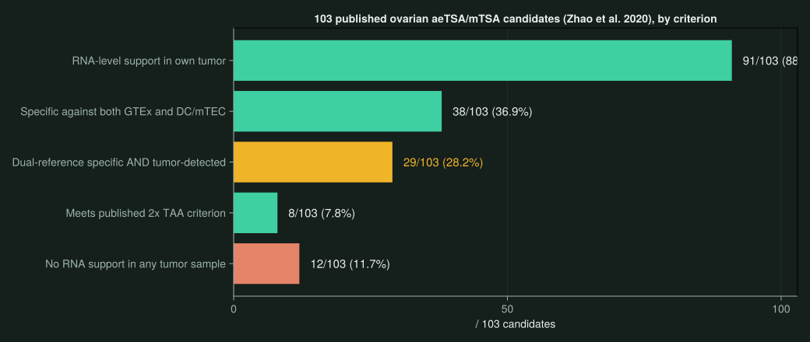
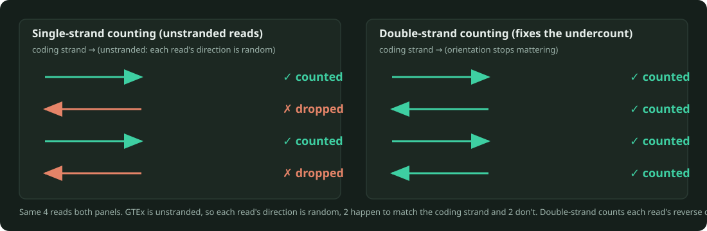
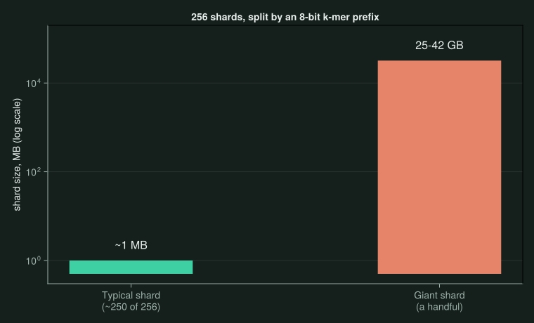
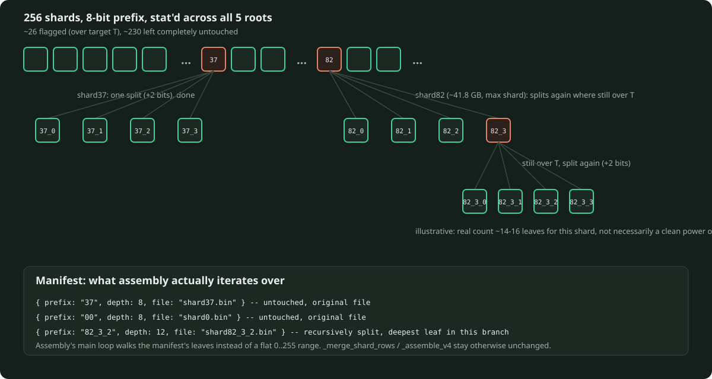

# NeoKCT {background-color="#1a1a2e"}

October 2026

---

## The Analysis Plan · A / B / C {#plan}

Three groups of tasks behind every number in this deck, tracked in `PAPER_TODO.md`:

- **A · Code prerequisites.** Library code needed before any analysis can run: progress logging, peptide query code, the reference index.
- **B · Table and performance numbers.** Engineering numbers for the paper: exact table statistics, query speed, build cost, the REINDEER benchmark.
- **C · Biology.** The analyses that carry the paper's actual claims, from the peptide sets through the tumor cohort.

| ID | Status |
|---|---|
| A | done, 1 minor item partial |
| B | done, 1 item partial (scaling series) |
| C | done, 2 items partial (C0, C8) |

Each group breaks out into individual tasks, in the appendix: [→ A0-A5](#appendix-a), [→ B1-B4](#appendix-b), [→ C0-C9](#appendix-c).

---

## Recap · Where Sep 17 Left Off

Last month's single open item under "Now": compare the pipeline against BamQuery on the GTEx cohort.

That became the C-arc on the plan above ([→ plan](#plan)), C0 through C9, now mostly done.

---

## The Headline

| | Sep 17 | Oct 15 |
|---|---|---|
| Manuscript | Methods + early results drafted | **Abstract through Discussion fully drafted, real numbers in** |
| Healthy reference | GTEx only, 2,487 samples | + second reference: 22-sample DC/mTEC cohort (C9) |
| Tumor validation | not started | **9-sample ovarian tumor cohort built and queried (C8/C10)** |
| GTEx table | single-strand (unstranded, random read orientation), built | double-strand rebuild in progress, fixes an undercounting bug |

. . .

First tumor cohort through the pipeline, and the first attempt at fixing a correctness bug in the production reference.

---

## Manuscript Status

The draft is essentially complete as of Sep 29: Abstract, all of Methods, Results 3.1 through 3.5, Figure 3 and Figure 4 captions, and the Discussion are all filled with numbers.

| Item | Blocked on |
|---|---|
| Zenodo DOI line | an actual deposit, archive already prepared |
| Figure 3 and Figure 4 | not drawn yet, captions and legends are done |
| B1, B2, C2, C7, C9, C10 reruns | the double-strand rebuild of the single-strand (unstranded) GTEx table ([→ Part 2](#rebuild)) |

---

## C8/C10 · The Tumor Cohort

A 9-sample ovarian tumor RNA-seq cohort (GEO GSE131880) was downloaded and built into a NeoKCT table.

| Metric | Value |
|---|---|
| Samples | 9 |
| Unique k-mers | 3.88 B |
| (sample, count) pairs | 6.52 B |
| Disk | 27.16 GB |

Getting there surfaced two problems along the way: a memory leak in `JelloFish.jl`'s counting kernel (a `Task[]` vector retaining every merge closure forever), and a corrupted source FASTQ at ENA, worked around via NCBI SRA.

---

## C8/C10 · Headline Numbers

The tumor table was queried against the 103 published ovarian aeTSA/mTSA candidates (Zhao et al. 2020), cross-referenced with GTEx and the DC/mTEC reference.

{fig-align="center" width="85%"}

---

## C9 · A Second Healthy Reference

The existing 22-sample cohort (19 blood DC + 3 mTEC, built for the BamQuery comparison) is also BamQuery's own canonical reference panel, reused here as an independent specificity check with no new sequencing needed.

A candidate can be called differently if it clears the specificity threshold against one reference but not the other, so whether it makes the clean list depends on which healthy-tissue cohort happens to be used:

| Call | Candidates |
|---|---|
| Specific under both references | 38 |
| Disqualified under both | 25 |
| Pass GTEx, disqualified by DC/mTEC | 12 |
| Pass DC/mTEC, fail somewhere in GTEx | 28 |

The 12 are the clinically interesting case: they'd clear a GTEx-only screen but show AIRE-driven thymic expression in mTEC, implying prior central-tolerance deletion, exactly what a second reference is meant to catch.

---

## Build Once, Query Forever

BamQuery's own published cost: 729.6 CPU-hours for a full GTEx run, on hardware different from ours.

Running BamQuery ourselves on the same machine as NeoKCT (oni), on the 22-sample C3 cohort (40.7h wall time, 32 cores), then scaling to GTEx size, gives ~1,301.6 CPU-hours instead, 1.78x BamQuery's own published figure. That same-hardware number is the basis for the 56x figure below.

| | Cost |
|---|---|
| BamQuery, published figure† | 729.6 CPU-h |
| BamQuery, same hardware as NeoKCT, scaled to GTEx size* † | ~1,301.6 CPU-h |
| NeoKCT build (one-time) | 227.3 h (9.47 days) |
| NeoKCT query (per session)** | 43.9 min |
| vs. BamQuery published figure† | **31x faster** |
| vs. same-hardware measurement* † | **~56x faster** |

<small>*extrapolated: measured directly on the 22-sample C3 cohort (14.3 CPU-h, 40.7h wall on 32 cores), then scaled up to GTEx's 2,487-sample size, not independently remeasured at full scale. 
**table load, one sequential read of the 1.4 TiB blob (43.8 min), plus the query itself against the real ~1,245-peptide set (8.1s), from the C4 GTEx run. 
†BamQuery's numbers are CPU-hours, NeoKCT's are wall-clock, multithreaded. Not a fully apples-to-apples comparison, the real selling point is the per-session wall-clock time on its own.</small>

---

## Part 2 · Why Rebuild GTEx At All {#rebuild}

After a conversation with Lemieux: the production GTEx table (2,487 samples, single-strand count) undercounts true supporting reads. GTEx's own RNA-seq libraries are confirmed unstranded (checked directly against GTEx's QC metadata, ~50% sense on both mates), meaning each read's orientation relative to the coding strand is effectively random. Single-strand counting only credits a read that happens to land in the coding-strand orientation, so on an unstranded library it silently drops close to half of all true support.

{fig-align="center" width="95%"}

---

## The Rebuild, Chronologically

| Step | What happened |
|---|---|
| Job 8113269 | failed wave 1 on disk exhaustion from unrelated leftover data, cleaned up, resubmitted |
| Job 8113291 | all 25 waves and 5 merges completed cleanly over ~8 days, merge-memory ceiling held steady at ~1,500 GB |
| Sample list | SRR5125583 found deleted from the shared export, resubmitted against a corrected 2,486-sample list, resume logic skipped all completed work |
| Final assembly | **3 consecutive OOM kills**, despite escalating memory 1,500 -> 1,650 -> 1,800 GB |

---

## The Assembly Puzzle

A 300 GB increase between attempts 1 and 3 barely moved the crash point. That argues against "just needs more memory."

Attempt 4 (`--cpus 6`, shrinking the internal concurrency window that controls how many shards are decoded and merged at once) helped, but only delayed the failure: it reached shard 78/256 before OOM-killing, past the 56/256 all three prior attempts died at, but still a crash. Neither more memory nor less concurrency actually fixed it, pointing at something structural in how the work is split, not how much of it runs at once.

---

## The Assembly Puzzle · Why: Shard-Size Skew

A k-mer is assigned to one of 256 shards by its top 8 bits alone, roughly the leading 1.6 amino acids of a 10-residue k-mer. Amino acid usage in real proteins is far from uniform, so shard sizes are wildly skewed.

{fig-align="center" width="70%"}

Whenever assembly's concurrency window happens to include one of the giant shards, it has to hold that shard's full content, across all 5 root partials at once, in memory. That's what's actually been blowing every ceiling tried so far, not the shard count.

---

## The Fix · Adaptive Prefix-Tree Sharding

Stat all 256 shards across the 5 roots, nearly free. Leave anything under a size target untouched. Split anything over it, and recurse only where the data is still dense.

{fig-align="center" width="100%"}

---

## The Fix · By the Numbers

The expensive parts, 13 days of CRAM counting and 5 hierarchical merges, are already done and safe on disk as 5 root partials. The fix only touches those already-merged shard files, not the raw data or the merge logic.

Real shard sizes, per root: median ~1 MB, 90th percentile ~20.7 GB, max ~41.8 GB, total ~1,526 GB. Almost all of that mass sits in roughly the top 10% of shards.

| | |
|---|---|
| Oversized shards (over target T, ~2-4 GB) | ~26 of 256 |
| Leaves needed to cover them | ~500 (the 41.8 GB shard alone needs ~14-16) |
| Untouched shards | ~230 |
| Peak memory per split | bounded by that one shard's size, ~42 GB worst case |

On disk: a manifest lists each leaf's prefix, bit-depth, and filename. Untouched shards keep their name (`shard37.bin`), split ones get child names (`shard82_0.bin` .. `shard82_15.bin`, recursively `shard82_3_2.bin` if a child itself needed splitting). Assembly's main loop walks the manifest's leaves instead of a flat 0..255 range, `_merge_shard_rows`/`_assemble_v4` stay otherwise unchanged.

A cheaper stopgap was also on the table: periodic `GC.gc()` calls in the assembly loop reclaim up to 43% of RSS on some batches, but there's no direct measurement of whether it helps on the specific giant-shard batch that actually needs it. This fixes the root cause directly regardless of how GC happens to behave on any given batch.

---

## What's Next · Engineering

| Priority | Task |
|---|---|
| **Done** | C8/C10 tumor cohort built, queried, written into manuscript |
| **Done** | C9 second reference reused as an independent specificity check |
| **Done** | Root cause of the assembly OOM found: shard-size skew, not memory or concurrency |
| **Now** | Incorporate the adaptive prefix-tree sharding fix, then rerun assembly against the manifest |
| **Maybe** | Stream `blob` during assembly instead of holding it RAM-resident |

---

## What's Next · The Rebuild Determines Everything Else

Nothing else blocks submission. Once the double-strand GTEx table finishes, every one of these needs a rerun on the corrected table before its current number is final:

| Depends on the GTEx table | Current single-strand (unstranded) number |
|---|---|
| B1, full-table statistics | 38.76 B k-mers, 1.39 TiB |
| B2, query benchmark | 18.5 µs/query, cold |
| C2, GTEx-scale BamQuery reproduction | 36/393, 15/66, 4/27 |
| C7, ablation false-TSA rate | 0.4% at c=5 |
| C9, second-reference cross-check | ~40% reclassified |
| C10, tumor-vs-normal specificity | 29/103 clean candidates |

---

# Questions? {background-color="#1a1a2e"}

`github.com/lemieux-lab/NeoKCT`

---

# Appendix {background-color="#1a1a2e"}

---

## A · Code Prerequisites, Detail {#appendix-a}

| ID | Task | Status |
|---|---|---|
| A0 | `_Prog` progress and RSS logging helper | done |
| A1 | Sample manifest and library sizes | partial, 1 sample's CRAM deleted from the shared export, needs imputation or exclusion |
| A2 | Peptide query code: prefix ranges, tiles, L<K / L=K / L>K | done |
| A3 | Generic merge-walk join primitive | done |
| A4 | Reference index: transcripts plus an in-frame canonical bit | done |
| A5 | C-terminal blind spot, documented as a limitation (0.85% of MAPs) | done |

---

## B · Table and Performance Numbers, Detail {#appendix-b}

| ID | Task | Status |
|---|---|---|
| B1 | Exact full-table statistics | done, 595.5 B pairs across 38.76 B k-mers |
| B2 | Query benchmark v2, cold/warm, thread-scaled | done |
| B3 | Construction resources and scaling | partial, scaling series (100/250/500/1,000-sample builds) not run |
| B4 | Same-alphabet benchmark against REINDEER | done, NeoKCT 98.12% vs. REINDEER 9.82% exact match against Jellyfish ground truth |

---

## C · Biology, Detail {#appendix-c}

| ID | Task | Status |
|---|---|---|
| C0 | What BamQuery's own paper actually publishes, read before planning anything | partial |
| C1 | Real peptide candidate sets assembled, 592 peptides plus controls | done |
| C2 | Reproduce BamQuery's published GTEx-scale statistics with NeoKCT | done |
| C3 | Per-peptide concordance on a small 22-sample public cohort, both tools run | done |
| C5 | Concordance and threshold calibration against BamQuery | done |
| C6 | Discordance triage: why BamQuery and NeoKCT disagree | done |
| C7 | Presence/absence ablation and random-occupancy controls | done |
| C8 | Tumor cohort: build, annotation, per-tissue profiles, tumor-vs-normal (C10) | partial, figures pending |
| C9 | Second healthy reference (DC/mTEC), an independent specificity check | done |
