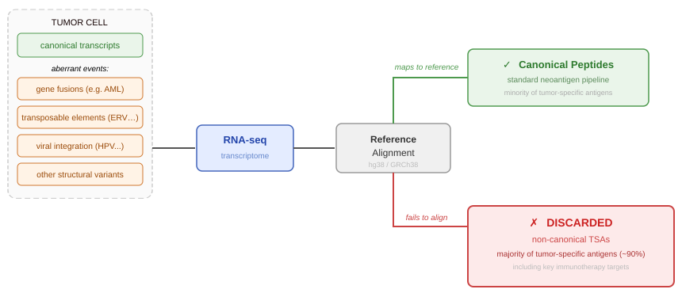
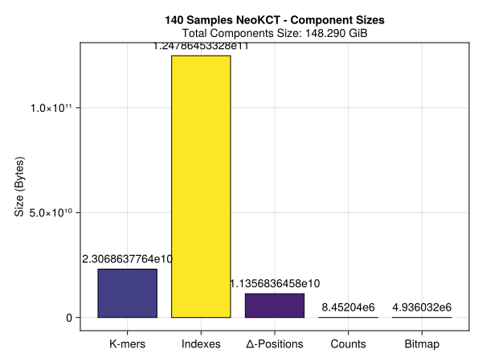
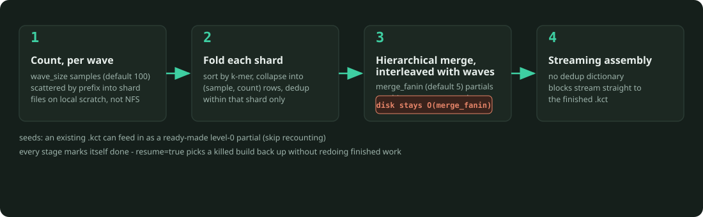
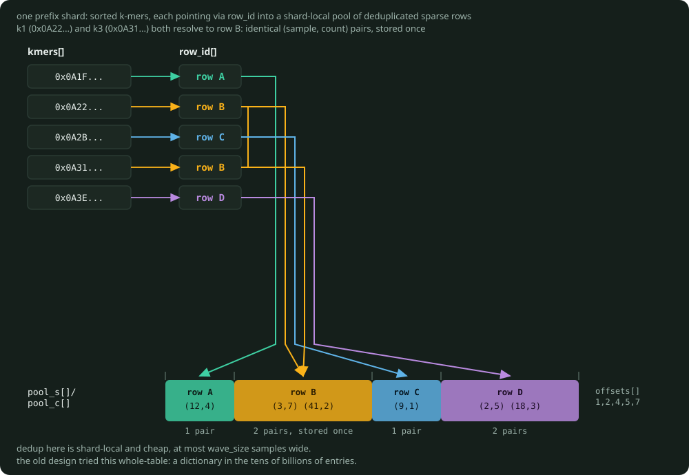
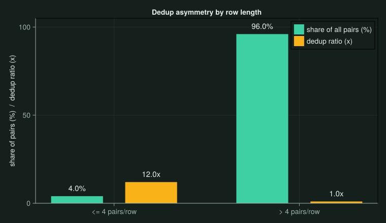
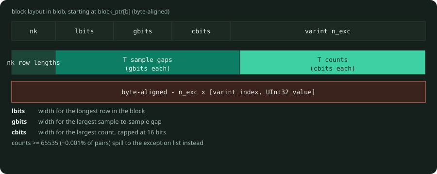

# NeoKCT · CountsLayer Unification {background-color="#1a1a2e"}

Full GTEx cohort finally loads, and the data structure got simpler to get there · September 2026

---

## Welcome, and a Quick Recap · What NeoKCT Is For

Reference-based analysis maps RNA-seq reads to a canonical transcriptome and discards whatever fails to align, missing most tumor-specific antigens (aeTSAs): gene fusions, transposable elements, viral integration, other structural variants.

::: {style="background-color:white; padding:16px; border-radius:8px; display:inline-block;"}
{fig-align="center" width="92%"}
:::

NeoKCT builds a reference-free, per-sample k-mer count table across large RNA-seq cohorts, so a candidate peptide can be traced back to its samples of origin without ever aligning to a reference.

---

## Why It's a Challenge

- Scale: tens of billions of distinct k-mers, across thousands of samples, each needing its own exact count, not an average
- Every added sample can add new k-mers, so the table has no natural ceiling as cohorts grow
- Existing tools trade this away: presence/absence only (Bloom-filter-based indexers), or counts averaged across similar sequences (REINDEER), because exact-for-everyone doesn't fit in memory at this scale

**NeoKCT's bet:** keep exact per-sample counts anyway, by being deliberate about disk vs. memory and compression at every layer. The rest of this talk is that engineering.

---

## The Headline

| | V3.0 (last meeting) | V4.0 (now) |
|---|---|---|
| Practical sample ceiling | ~140 samples | **2,487 samples, full cohort** |
| `flat_cids` at 140 samples | 78% of a ~150 GB table | n/a, structure removed |
| Table status | never finished a full GTEx build | **built & verified: spot-check exact match, 86/86 tests pass** |

. . .

First time the entire 2,400+ sample GTEx cohort has loaded into one table.

---

## Recap · Where July 30 Left Off

- Word-size sweep done: **`UInt64`** confirmed as the production word size
- Full GTEx build (2,489 samples, target scale to match BAMQuery) launching on the existing Slurm-batched `push!` pipeline

---

## Why the Building Scheme Changed First

The `push!`-based pipeline (V1.0-V3.0) that launched the July 30 build was never going to reach full cohort scale.

| Metric | Push-based building |
|---|---|
| Build time, 100 samples | ~36h (V1.0), ~19.5h after CSR rework (V1.2) |
| Memory requested, 100 samples | ~500 GB (5 GB/sample safety margin) |
| Memory cap hit at | ~360 samples (1800 GB Slurm ceiling) |

. . .

Aug 27: replaced outright with **`build_kct_streaming`**, an external merge sort with no in-memory growth as samples are added.

---

## Where the Bytes Went, V3.0 at 140 Samples

`flat_cids` alone is 78% of a ~150 GB table, and growing superlinearly with sample count. This is the concrete evidence, not just the headline number.

{fig-align="center" width="60%"}

---

## How `build_kct_streaming` Actually Works

Replaces `push!` outright: an external k-way merge sort, same family as KMC / DSK. Nothing dense is resident until the very last stage, and no per-sample memory growth like the old scheme.

{fig-align="center" width="95%"}

---

## Inside a Partial Shard

What stage 2 (fold) and stage 3 (merge) actually pass around: `_PartialShard`, sorted k-mers pointing into a shard-local CSR pool of deduped `(sample, count)` rows.

{fig-align="center" width="95%"}

---

## Then the Build Hit a Wall

Even the new streaming builder wasn't done yet. Two production runs, both died mid-build:

| Run | Failure | Root cause |
|---|---|---|
| `GTEX_AA_STREAM` | crashed in wave 3 | `samtools` SIGPIPE-at-EOF in `cram_hash` |
| `GTEX_DNA_STREAM` | wedged mid-fold of wave 8 | shared export filled after ~1.2 TB of wave partials |

A build like this needs several TB of real headroom for `out_dir`, plus fast local scratch for `--tmp-dir` during a wave. Fixed by moving `out_dir` to **muninn** and `--tmp-dir` to **Oni's local SSD scratch**.

---

## Fix 1 · Bound the Disk Footprint

Old: hierarchical merge ran only after **all** waves finished. Live partials on disk grew as `O(n_waves)`.

. . .

New: merge runs **interleaved** with wave production. Each group of `merge_fanin` partials combines as soon as its inputs are ready, and those inputs are deleted immediately.

**disk footprint: `O(merge_fanin)` waves resident, not `O(n_waves)`**

---

## Fix 2 · The Dedup Assumption Was Wrong

Sep 1: the AA run crashed again, this time on the old `max_pool_gb` tripwire. Measured the actual dedup behavior on real GTEx data before rebuilding anything:

| Row length | Share of all pairs | Dedup ratio |
|---|---|---|
| ≤ 4 pairs | ~4% | ~12x |
| **> 4 pairs** | **~96%** | **~1.0x (basically unique)** |

{fig-align="center" width="65%"}

---

## Fix 2 · Why That Kills the Dedup Pool

The rows holding almost all the data barely dedup at all.

- A shared dedup dictionary costs about what it saves
- At full cohort scale it needs **tens of billions of entries**
- That dictionary is exactly what OOM'd the previous design during assembly

**Decision:** drop the dedup pool entirely.

---

## New Structure · `CountsLayer` (was `SparseCountsLayer`)

No dedup pool. Instead: each k-mer's `(sample, count)` row packed **inline**, 64 k-mers per block, frame-of-reference bit widths chosen per block.

{fig-align="center" width="90%"}

---

## Old vs. New

| | V3.0 · removed | V4.0 · only path now |
|---|---|---|
| Storage | CSR: `n_cids` + `flat_cids` in a `PackedArray` | inline 64-k-mer blocks, per-block bit widths |
| Grows by | incremental `push!`, one batch at a time | whole-table streaming merge |
| Dedup | cross-k-mer word dedup via `collapse!` | none, measured not worth it |
| Mutability | mutable: `push!`, `collapse!`, `sort!`, `repack` | read-only, all four now raise |
| File format | v1.2–v3.0, plus RichKCT v2.0 | v4.0 only (`KCT_VERSION = 4.0`) |
| Reading old files | fully retrocompatible on `main`, read v1.2–v3.0 + RichKCT v2.0 | dropped from `main`, use `git checkout V4.0-last-retrocompat` |

---

## Why Read-Only Is Fine

Bit widths (`lbits`/`gbits`/`cbits`) are chosen per block from every row it holds. Adding one sample to an existing block can mean re-deriving widths and shifting every neighbor, so a cheap single-sample `push!` was never really on the table for this format.

. . .

Rebuilding from scratch with `build_kct_streaming` is already faster than a single incremental `push!` onto an already-built table, and an existing `.kct` can feed back in as a `seeds` partial so finished work is never redone.

**Real case:** 2 of the 2,489 targeted GTEx samples had corrupted source files. They were dropped and the table rebuilt from the on-disk wave partials, not patched in place.

---

## The Full GTEx Table, Verified

| Metric | Value |
|---|---|
| Samples | **2,487** (of 2,489 targeted, 2 dropped: corrupted source) |
| Unique k-mers | 38.76 B |
| (sample, count) pairs | ~685.7 B |
| Disk, total | **1.39 TiB** |
| Bytes / k-mer | 39.33 |
| Lookup | ~18.5 µs |

. . .

| Component | Size | Note |
|---|---|---|
| K-mer `DeltaArray` | 147 GiB | sorted k-mers, delta-encoded |
| `block_ptr` | 4.5 GiB | one `UInt64` offset per block |
| packed `blob` | 1.24 TiB | posting lists, memory-mapped on load |

---

## Verification

| Check | Result |
|---|---|
| Unit tests | **86 / 86 passing**, old push!/collapse! testsets rewritten onto `build_kct_streaming` |
| Live production file | **header-verified**: 38,764,964,245 k-mers, 2,487 samples, 1.239 TiB blob, exact match |
| Spot check | 10,000 random k-mers x 10 random samples validated against `jellyfish`, exact match |

---

## Where NeoKCT Fits

Two independent axes, not a single head-to-head:

1. **General-purpose k-mer count table.** Exact like REINDEER, but faster per-thread and handles full-cohort abundance on one large-memory node (REINDEER needed 7 TB external memory to build a cohort a third the size).
2. **Applied to peptides.** Joint peptide-to-RNA-seq querying at GTEx scale with real abundance. Neither REINDEER (nucleotide-only, averaged) nor k4neo (nucleotide-only, presence/absence) offers this today.

---

## vs. REINDEER (Marchet et al. 2020)

| Metric | NeoKCT | REINDEER |
|---|---|---|
| Samples indexed | 2,487 (GTEx) | 2,585 (SRA RNA-seq) |
| Distinct k-mers | 38.76 B | 3.75 B |
| Memory, query-resident | 1.4 TB | 56 GB (construction peak) |
| Query throughput / thread | 54,000 k-mers/s | ~1,600 k-mers/s |
| Construction footprint | not yet benchmarked | up to 7 TB external memory, 1/3 the cohort |
| Abundance | exact, per-sample | exact, averaged per unitig |

. . .

~30x REINDEER's own per-thread rate, on a k-mer collection an order of magnitude larger. Caveat: NeoKCT's k-mers are peptide, REINDEER's are nucleotide, not directly comparable as raw counts. A same-alphabet benchmark is the clean claim, and it hasn't been run yet.

---

## vs. k4neo (2026 preprint, TRON/BioNTech)

| | NeoKCT | k4neo |
|---|---|---|
| Healthy-tissue samples | 2,487 (GTEx) | 18,960 (GTEx v9 + curated SRA/GEO/ENCODE) |
| Tumor index | not yet | TCGA: 10,328 tumor + 737 adjacent normal |
| Index type | exact abundance | presence/absence only |
| Peptide-level query | yes | no, nucleotide/transcript level only |

k4neo never joins to mass-spec-identified peptides. That query mode is central to NeoKCT and has no equivalent in their pipeline.

---

## Why Exact Counts Might Matter More Than Speed

- REINDEER shares one averaged count across every k-mer in a unitig
- A novel junction is short, sitting inside otherwise common, broadly-expressed exon sequence, exactly where averaging blends a rare signal into its common neighbors' abundance
- k4neo's ground-truth benchmark (9 indexers, real splice junctions): REINDEER was the **only** method producing false positives on sample-specific junctions, that same short-signal-in-common-context shape
- An aeTSA has that same shape: aberrant, present in essentially one tumor, and required to read as absent across the healthy reference cohort it's screened against

**Why it applies to us:** NeoKCT never averages, each k-mer keeps its own literal per-sample counts. Mechanistically, that should avoid REINDEER's specific failure mode on aeTSA-like signal. Hypothesis, not yet measured.

---

## What's Next · Engineering

| Priority | Task |
|---|---|
| **Done** | Full GTEx AA table built & verified: 2,487 samples, 38.76B k-mers, 1.39 TiB |
| **Now** | Compare the pipeline against BAMQuery on the GTEx cohort |
| **Near** | Stream `blob` during DNA assembly, currently RAM-resident, peak ~1.5 TB |

---

## What's Next · Toward Publication

| Priority | Task |
|---|---|
| **Next** | Nucleotide-mode benchmark against REINDEER, apples-to-apples units |
| **Next** | Reuse k4neo's splice-junction ground truth to measure sensitivity/specificity vs. REINDEER |
| **Later** | Reproduce k4neo's CLDN18/CTA expression analyses with real per-sample counts |
| **Later** | Benchmark construction-time memory footprint, not just query-time |

---

# Questions? {background-color="#1a1a2e"}

`github.com/lemieux-lab/NeoKCT`
