# Introduction {background-color="#1a1a2e"}

---

## Why tumor-specific antigens matter

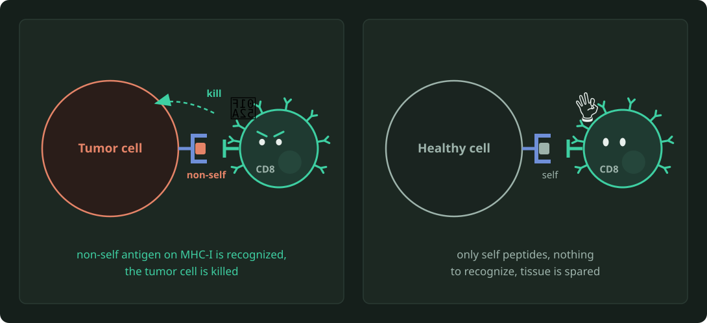{fig-align="center" width="75%"}

<small>A tumor-specific antigen (TSA) is a peptide shown on MHC-I by the tumor and by no healthy cell, so T cells aimed at it hit the tumor and leave healthy tissue alone. That makes TSAs targets for vaccines and T cell therapies.</small>

---

## Where MHC-I peptides come from

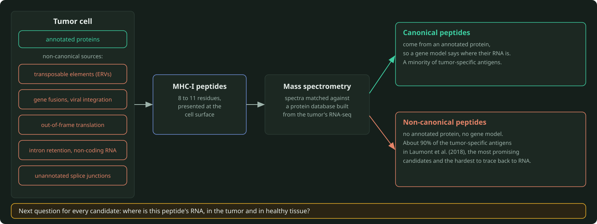{fig-align="center" width="95%"}

<small>~90% of the TSAs in @laumont2018 came from allegedly non-coding regions.</small>

---

## The question behind every TSA project

Two questions for every candidate from mass spectrometry:

| Question | Why it matters |
|---|---|
| Is it expressed in the tumor? | it has to come from the tumor's RNA |
| Is it absent from normal tissues? | Auto-immunity risk |

**Both are answered by counting RNA-seq reads**. For a new peptide, any read in any sample could be the one.

---

## How much data that is

GTEx: RNA-Seq, 2,486 healthy samples, 62.6 billion distinct 10-amino-acid fragments.

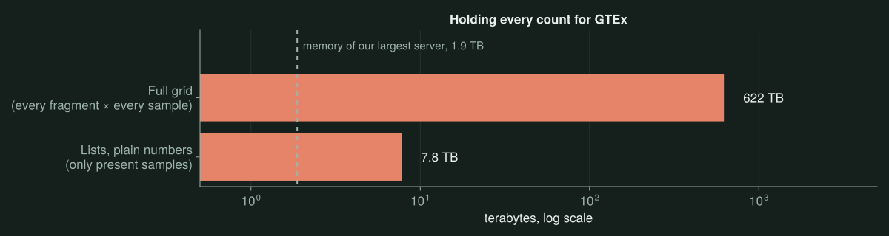{fig-align="center" width="85%"}

{.absolute top=566 left=1450 width="250"}

---

## Why it has to fit in memory

| | Disk | Memory (RAM) |
|---|---|---|
| Think of it as | the archive in the basement | your desk |
| Size on our largest server | plenty | 1.9 TB |
| Fetching one block of counts | ~17 ms | ~61 µs, about 300× faster |

A peptide query jumps around the table, so those parts have to be on the desk.

{.absolute top=470 left=830 width="250"}

---

## What existing tools give up to fit in memory

| Tool | Keeps only | Cost |
|---|---|---|
| Gene expression tables (GTEx portal) | one number per gene | most TSAs are invisible |
| BamQuery [@ruizcuevas2023] | nothing, re-reads the BAMs where the genome places the peptide | ~730 CPU-hours per list, 199 of 550 peptides unplaced |
| REINDEER [@marchet2020] | averaged counts over stretches of fragments, drops fragments seen once | 18% of counts exact |
| Raptor [@seiler2021] | present or absent | no counts, some false hits |

<small>The 550 peptides: 447 published tumor antigens from the BamQuery paper (DLBCL and mutated) and 103 ovarian tumor antigens from @zhao2020.</small>

---

## Why approximate isn't safe for TSAs

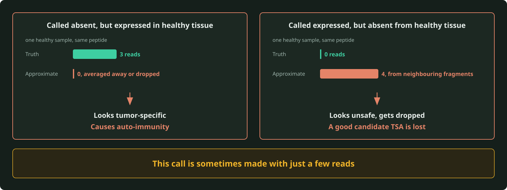{fig-align="center" width="92%"}

---

## The goal

::: {style="text-align: center; font-size: 2.1em; line-height: 1.3; margin-top: 1.2em; margin-bottom: 1.4em;"}
A TSA discovery tool that scales<br>to large cohorts, **without compromise**
:::

::: {style="font-size: 1.15em; line-height: 1.7; color: #9db3ab; width: 78%; margin: 0 auto;"}
1. **Store** every tumor and normal k-mer with its exact count, in one reusable table
2. **Optimize** it until it fits in memory, without giving up correctness
3. **Query** any peptide against tumor and normal tissue in microseconds
:::

---

## A closer look at BamQuery

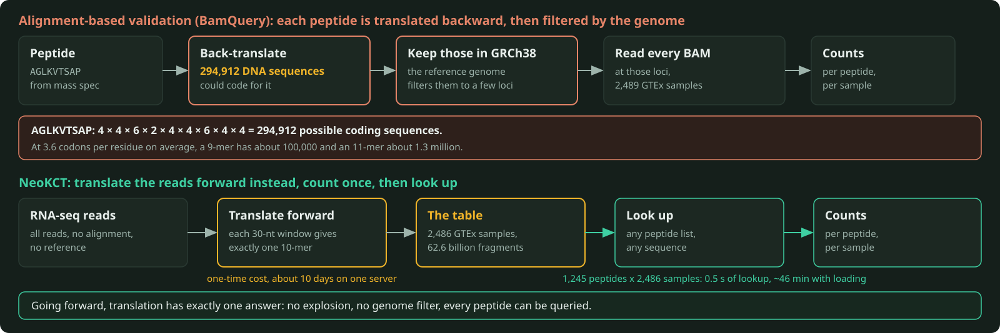{fig-align="center" width="100%"}

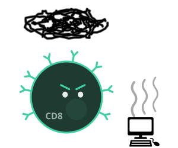{.absolute top=730 left=140 width="312"}

---

## No compromises

::: {style="font-size: 1.35em; line-height: 1.5;"}
Keep every fragment of every sample with its exact count, and make it fit.
:::

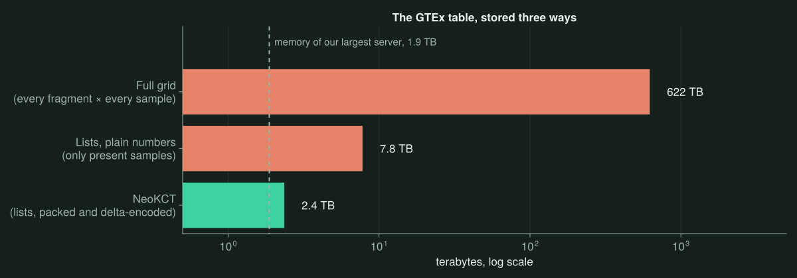{fig-align="center" width="78%"}

{.absolute top=680 left=850 width="250"}

# The New K-mer Count Table (NeoKCT) {background-color="#1a1a2e"}

---

## Cut every read into fragments, count them all

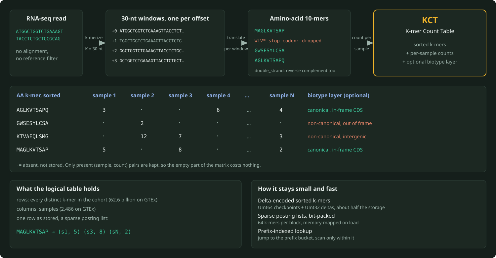{fig-align="center" width="92%"}

---

## The table, built once for GTEx

| | GTEx table |
|---|---|
| Samples | 2,486 (50 tissues) |
| Distinct 10-amino-acid fragments | 62.6 billion |
| Size on disk | 2.15 TiB |
| Build | once, about 10 days on one server |
| Finding one fragment | ~25 µs |

# Under the hood: 155 trillion values on one server {background-color="#1a1a2e"}

---

## Store it like a search engine

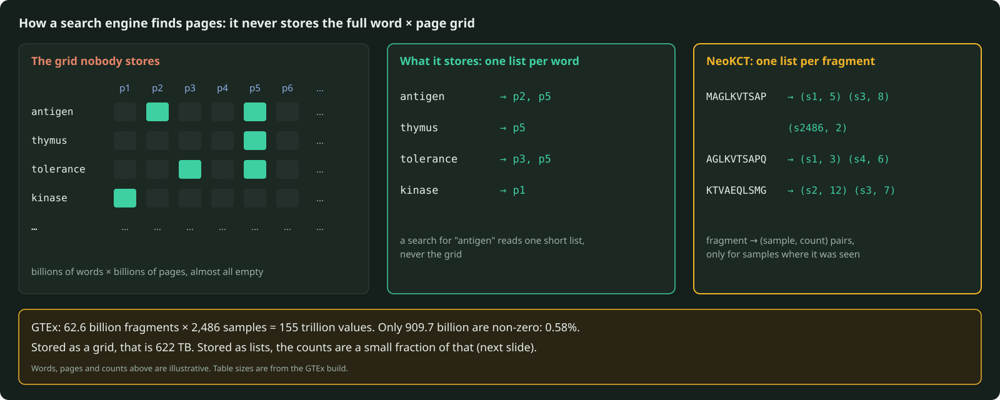{fig-align="center" width="100%"}

---

## Write down only the gaps

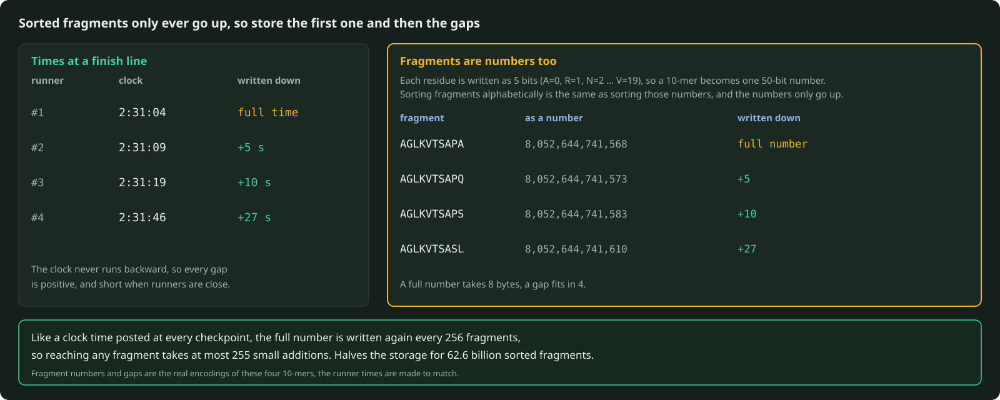{fig-align="center" width="100%"}

---

## Drop the leading zeros

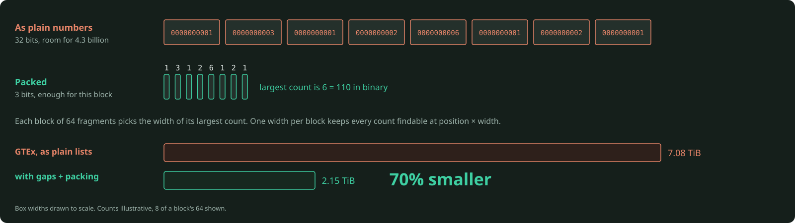{fig-align="center" width="92%"}

{.absolute top=556 left=1150 width="250"}

# Does it give the right answer? {background-color="#1a1a2e"}

---

## Approximate was never an option

| 200 GTEx samples, Jellyfish counts as ground truth | Exact counts returned |
|---|---|
| NeoKCT | **98.5%** <span style="font-size: 0.6em; vertical-align: baseline; color: #9db3ab;">(100% when keeping reads that contain undetermined nucleotides)</span> |
| REINDEER [@marchet2020] | 18.0% <span style="font-size: 0.6em; vertical-align: baseline; color: #9db3ab;">(drops k-mers seen once by default, 40% exact on the rest)</span> |

<small>Each tool scored against Jellyfish with its own strand convention: forward strand for NeoKCT, both strands for REINDEER. 75,886 (k-mer, sample) pairs. REINDEER averages counts across unitigs.</small>

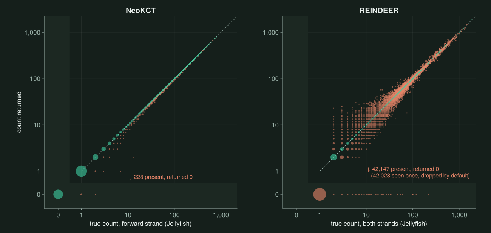{fig-align="center" width="66%"}

{.absolute top=640 left=1560 width="250"}

---

## Does it agree with BamQuery?

Same 22 samples (dendritic cells and mTECs), same 550 published tumor antigens:

:::: {.columns}
::: {.column width="45%"}
| | Result |
|---|---|
| (peptide, sample) pairs compared | 7,722 |
| Same call at 8.55 rphm | 340 of 351 placed peptides (97%) |
| Called differently | 11, 10 of them seen only by NeoKCT |
| Peptides BamQuery couldn't place | 199 of 550, all counted by NeoKCT |
| ... with reads in these samples | 27, 8 of them above 8.55 rphm |
:::
::: {.column width="55%"}
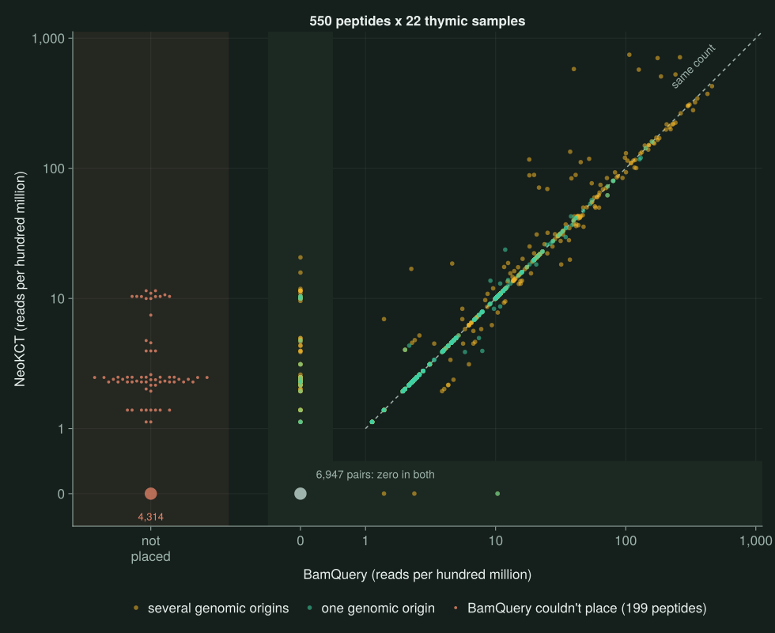{fig-align="center" width="80%"}
:::
::::

# What this enables {background-color="#1a1a2e"}

---

## Replacing BamQuery for expression screening

| | BamQuery | NeoKCT |
|---|---|---|
| A new peptide list against GTEx | 729.6 CPU-hours | ~46 min |
| A new threshold or tissue grouping | rerun | re-filter the same matrix |
| Peptides the genome can't place | not counted (199 of 550, 36%) | counted |
| Which locus the reads came from | exact genomic position | biotype layer: protein-coding, lncRNA, intergenic, in-frame or not |


<small>An optional locus layer, storing exact genomic positions, is also planned. The KCT structure makes this easy.</small>

{.absolute top=520 left=1250 width="250"}

---

## A tumor cohort through the same pipeline

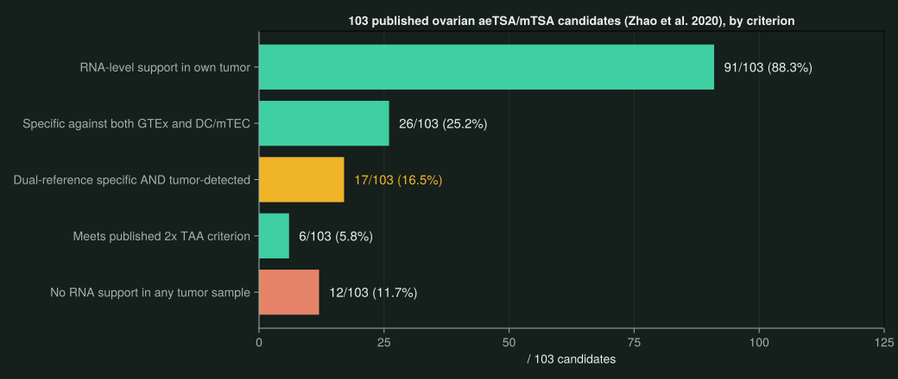{fig-align="center" width="80%"}

<small>9 ovarian tumor RNA-seq samples (GSE131880), queried with the 103 ovarian tumor antigens published by @zhao2020 (91 from non-coding regions, 12 mutated).</small>

---

## Summary

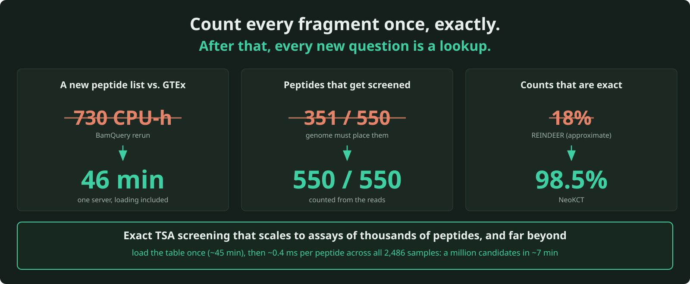{fig-align="center" width="92%"}

Manuscript being finalised for submission before the end of 2026.

---

## Where this goes next

| When | Direction | What it needs |
|---|---|---|
| Dec 2026 | Paper submission | manuscript being finalised |
| Early 2027 | Discovery before MS: tumor fragments absent from all normals | already supported, one pass comparing two tables |
| Mid-late 2027 | Work directly on the MS spectra instead of the peptides we infer from them | matching spectra against the fragments in the table, skipping the protein database |
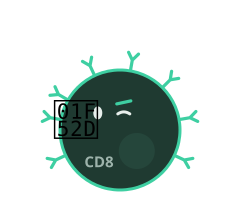{.absolute top=760 left=1500 width="250"}

# Questions? {background-color="#1a1a2e"}

```{=html}
<style>
/* reveal.js centers section-title slides by shifting the whole section down, which drags
   .absolute positions with it. Center with flexbox instead so top=0 is the real slide top. */
.reveal .slides section#questions.present { top: 0 !important; height: 100%; display: flex !important; flex-direction: column; justify-content: center; }
</style>
```

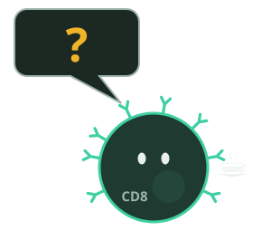{.absolute top=0 right=0 width="320"}

`github.com/lemieux-lab/NeoKCT`

Thanks to Sébastien Lemieux and the Lemieux lab.

---

## References

::: {#refs}
:::

# Appendix {background-color="#1a1a2e" visibility="uncounted"}

---

## What that costs in practice {visibility="uncounted"}

| | Alignment-based check |
|---|---|
| One peptide list against GTEx | 729.6 CPU-hours (published) [@ruizcuevas2023] |
| Same on our server, scaled from 22 samples* | ~1,301.6 CPU-hours |
| A second list, a new threshold, a new cohort | all of it again |
| Peptides with no match in the reference genome | not counted (199 of 550) |

<small>*extrapolated from a 22-sample run, not remeasured at full scale.</small>

---

## Cost of a new question {visibility="uncounted"}

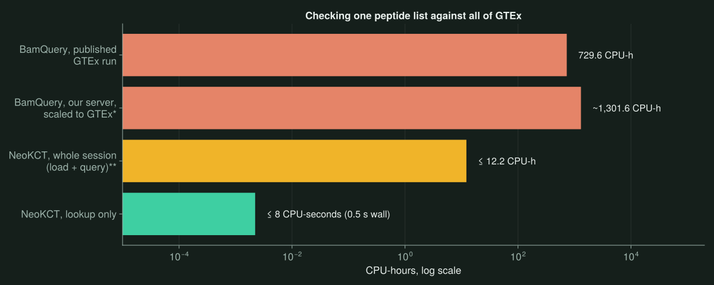{fig-align="center" width="85%"}

<small>*extrapolated from a 22-sample run. **45.6 min on 16 threads, an upper bound. NeoKCT bars converted to CPU-hours from wall-clock times.</small>

---

## Is the signal real? {visibility="uncounted"}

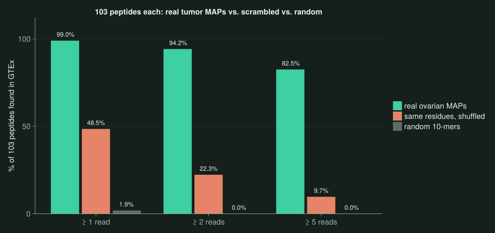{fig-align="center" width="78%"}

103 published ovarian tumor MAPs [@zhao2020] against GTEx. Shuffled peptides mostly vanish, random ones never appear.

---

## Two healthy references catch different things {visibility="uncounted"}

The same 103 ovarian candidates against GTEx and against 22 dendritic cell + mTEC samples:

| Call | Candidates |
|---|---|
| Specific under both | 26 |
| Disqualified by both | 31 |
| Pass GTEx, expressed in mTEC or DC* | 6 |
| Pass DC/mTEC, expressed in GTEx | 40 |

<small>*thymic expression suggests the matching T cells were deleted during tolerance.</small>

---

## How the table is built {visibility="uncounted"}

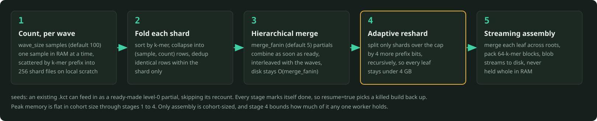{fig-align="center" width="100%"}

<small>Like sorting a 2,500-student class's exams: each TA sorts one stack of 100, stacks are merged five at a time.</small>

---

## Uneven fragments and adaptive resharding {visibility="uncounted"}

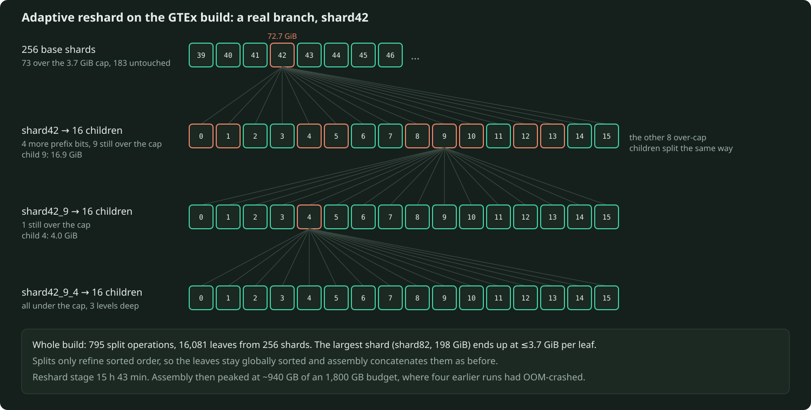{fig-align="center" width="90%"}

<small>Like a dictionary where the S volume is a hundred times thicker than X. Oversized units are split until each is under 3.7 GiB.</small>

---

## Memory-Mapping (or the magic library ✨) {visibility="uncounted"}

Catalog (265 GB index) on the desk, books (2 TiB of counts) in the basement. One trip brings back a whole shelf, and a peptide's fragments sit side by side.

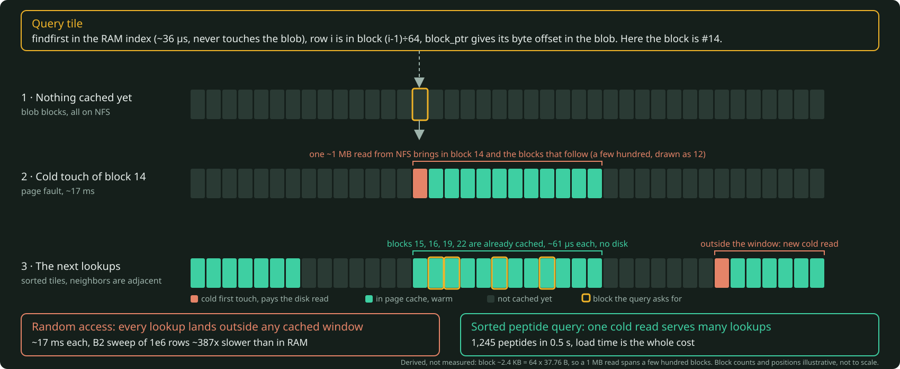{fig-align="center" width="92%"}

---

## Querying a peptide {visibility="uncounted"}

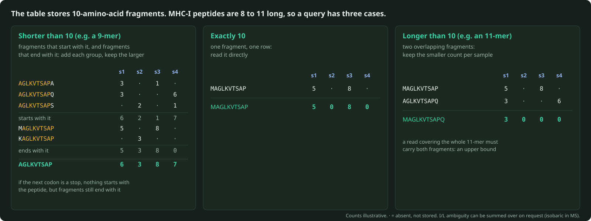{fig-align="center" width="100%"}

---

## Reads can come from either strand {visibility="uncounted"}

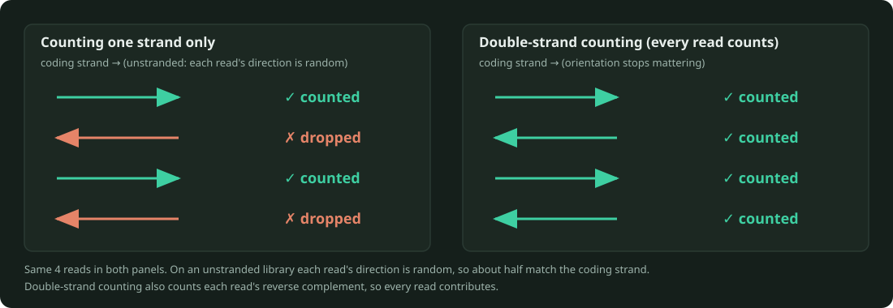{fig-align="center" width="90%"}

GTEx libraries are unstranded, so every read is counted together with its reverse complement.
