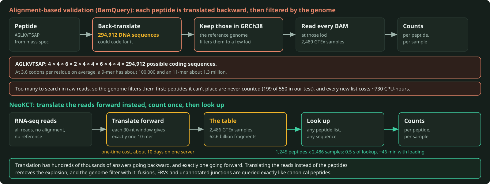
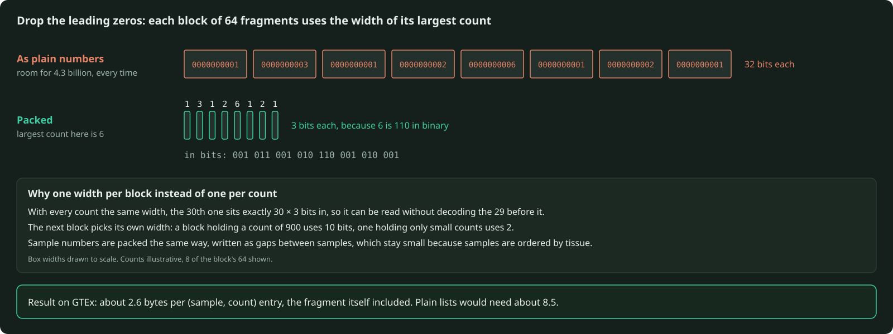
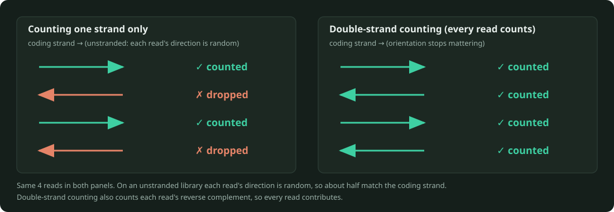

# Approximate was never an option {background-color="#1a1a2e"}

GTEx's 62 billion k-mers with exact counts crammed in memory for reference-free antigen screening

---

## Where MHC-I peptides come from

{fig-align="center" width="95%"}

<small>Around 90% of the TSAs identified by @laumont2018 came from allegedly non-coding regions, and most non-canonical proteins are found uniquely in either the proteome or the immunopeptidome [@cuevas2021].</small>

---

## The question behind every TSA project

You have a list of MHC-I peptides from mass spectrometry. Before anyone spends months on one of them, two questions need an answer:

| Question | Why it matters |
|---|---|
| Is it expressed in the tumor? | The peptide has to come from somewhere in the tumor's RNA |
| Is it absent from normal tissues? | Expression in healthy tissue means toxicity risk, or a T-cell repertoire already deleted by tolerance |

Both are answered by counting RNA-seq reads, in the tumor and in thousands of healthy samples. For a peptide nobody has looked at before, any read in any sample could be one that codes for it.

---

## How much data that is

GTEx alone has 2,486 healthy samples from 50 tissues. Cut every read into 10-amino-acid fragments and you get 62.6 billion distinct fragments, spread over 909.7 billion (fragment, sample) combinations, each with its own count.

{fig-align="center" width="85%"}

Even written as plain lists, holding every count takes four times the memory of our largest server.

---

## Why it has to fit in memory

A computer stores data in two places, and a peptide query cares a lot about which one.

| | Disk | Memory (RAM) |
|---|---|---|
| Think of it as | the archive in the basement | your desk |
| Size on our largest server | plenty | 1.9 TB |
| Fetching one block of counts, measured on our table | ~17 ms | ~61 µs, about 300× faster |
| Good at | reading everything in order, once | jumping straight to any entry |

A peptide list sends you to scattered spots in the table, so the parts a query jumps around in have to be on the desk. Leave them in the basement and every candidate pays the 17 ms trip, many times over.

---

## What existing tools give up to fit in memory

| Tool | To hold less, it keeps only | What that costs |
|---|---|---|
| Gene expression tables (GTEx portal) | one number per gene | peptides outside gene models, most TSAs, are invisible |
| BamQuery [@ruizcuevas2023] | nothing in memory: it re-reads the alignments from disk for every list, only where the genome places the peptide | ~730 CPU-hours per new list, and 199 of 550 peptides could not be placed |
| REINDEER [@marchet2020] | one averaged count per stretch of fragments that tend to occur together | approximate counts, 9.8% exact in our benchmark |
| Raptor [@seiler2021] | present or absent, in a compact probabilistic filter | no counts at all, and a small rate of false hits |

Each of these trades exists to shrink what must sit in memory for queries to be fast. They are reasonable for many questions, but not for this one.

---

## Why approximate isn't safe for TSAs

A specificity screen can be wrong in two directions, and neither is cheap:

| Mistake | How an approximation causes it | What it costs |
|---|---|---|
| Called absent, but expressed in a healthy tissue | a few reads in one testis or brain sample get averaged away, or are never looked at because the peptide sits outside a gene or the genome can't place it | a candidate moves forward with a toxicity or tolerance problem nobody saw |
| Called expressed, but absent | an averaged count borrowed from neighbouring fragments, or a filter's false hit, lands in a healthy sample | a real TSA gets dropped after months of MS and validation work |

Presence/absence can't even apply a threshold: one stray read and ten thousand reads look the same. The decision lives at low counts in a handful of samples, which is exactly where approximations are least reliable.

With exact counts, a threshold like 8.55 reads per hundred million means the same thing in every sample, and any wrong call comes from the biology or the sequencing, with nothing added by the index.

---

## A closer look at BamQuery

{fig-align="center" width="100%"}

---

## No compromises

::: {style="font-size: 1.35em; line-height: 1.5;"}
Keep every fragment of every sample with its exact count, and do the engineering needed to make that fit.
:::

{fig-align="center" width="78%"}

The table is built once, from reads translated forward, so no reference genome is involved. The part a lookup jumps around in, the 265 GB index of fragments, stays in memory. The counts sit on disk in sorted order, so one trip brings back a peptide's neighbours with it.

---

# Our approach: count once, look up forever {background-color="#1a1a2e"}

---

## Cut every read into fragments, count them all

{fig-align="center" width="92%"}

---

## The table, built once for GTEx

| | GTEx table |
|---|---|
| Samples | 2,486 (50 tissues) |
| Distinct 10-amino-acid fragments | 62.6 billion |
| (sample, count) entries stored | 909.7 billion |
| Size on disk | 2.15 TiB |
| Build | one time, about 10 days on one server* |
| Finding one fragment | ~25 µs |

<small>*9 days 13 hours of wall time: 7 days 8 hours of counting and merging, then 2 days 6 hours of assembly.</small>

---

# Under the hood: 155 trillion values on one server {background-color="#1a1a2e"}

---

## Store it like a search engine

{fig-align="center" width="100%"}

---

## Drop the leading zeros

Nobody writes a count of 6 as 0000000006, but a computer storing plain numbers does: every count gets room for 4.3 billion. Most counts in the table are 1, 2 or 3.

{fig-align="center" width="92%"}

---

## Write down only the gaps

{fig-align="center" width="100%"}

---

## A library, not a warehouse

The card catalog (where every fragment is, 265 GB) sits on the desk, in memory. The books (2 TiB of counts) stay in the basement, on disk. A trip downstairs is slow, but you bring back the whole shelf section with it, and a peptide's fragments sit side by side in sorted order:

{fig-align="center" width="92%"}

---

# Does it give the right answer? {background-color="#1a1a2e"}

---

## Approximate was never an option

First check: after all that packing, does every count come back exactly as it went in? Same samples through NeoKCT and REINDEER, compared against a standard k-mer counter.

| Same 200 GTEx samples, DNA 31-mers, Jellyfish counts as ground truth | Exact count returned |
|---|---|
| NeoKCT | **100%\*** |
| REINDEER [@marchet2020], the reference abundance index | 9.82% |

For antigen screening, the signal that matters most is a peptide seen at a low count in one healthy sample. That is exactly what averaging blurs away.

<small>\*98.12% as measured. The remaining differences all come from reads containing an N, which NeoKCT discards whole while Jellyfish keeps the k-mers on either side of the N.</small>

---

## Does it agree with BamQuery?

Both tools run on the same 22 public samples (blood dendritic cells and mTECs), same peptides:

| | Result |
|---|---|
| (peptide, sample) pairs compared | 7,722 |
| Rank correlation of counts | 0.89 |
| Count scale (NeoKCT ÷ BamQuery) | 1.0, log-log slope 0.98 |
| Peptides BamQuery could place in the genome | 351 of 550 |
| Same expressed / not-expressed call at 8.55 rphm | 337 of 351 (96%), kappa 0.89 |
| Sensitivity / specificity, BamQuery as reference | 93.8% / 96.7% |
| Called differently | 14 (9 only NeoKCT, 5 only BamQuery) |

<small>Half of the 14 disagreements are peptides with several possible genomic origins, where an alignment-based count depends on which loci get considered.</small>

---

# What this enables {background-color="#1a1a2e"}

---

## Replacing BamQuery for expression screening

Give a list of peptides, get back a peptide × sample matrix in reads per hundred million, labeled by tissue, ready for the same 8.55 rphm threshold.

| | BamQuery | NeoKCT |
|---|---|---|
| A new peptide list against GTEx | 729.6 CPU-hours | ≤ 12.2 CPU-hours, ~46 min |
| A new threshold or tissue grouping | rerun | re-filter the same matrix |
| Peptides the genome can't place (fusions, unannotated junctions, ...) | not counted | counted like any other |
| Which locus the reads came from | yes, per genomic location | no, coarse biotype annotation only |

For "is it expressed, and where in normal tissue", NeoKCT can take over. For "which gene or locus does it come from", BamQuery's alignment is still the tool.

---

## A tumor cohort through the same pipeline

{fig-align="center" width="80%"}

<small>9 ovarian tumor RNA-seq samples (GEO GSE131880, the samples behind the published MS data), built into their own table and queried with the same 103 candidates.</small>

---

## Summary

Checking a peptide against healthy tissue used to mean a pipeline run per list, and it skipped every peptide the reference genome couldn't place. NeoKCT counts every 10-amino-acid fragment of GTEx once, exactly, and turns that check into a lookup.

| Today | With NeoKCT |
|---|---|
| ~730 CPU-hours per peptide list, so screening gets rationed | every MS run's full candidate list, in under an hour |
| 199 of 550 peptides never screened, the genome couldn't place them | every peptide counted, canonical or not |
| a new threshold or tissue grouping means a rerun | re-filter the same matrix |
| start from MS, then go check the RNA | also start from RNA: fragments present in a tumor and absent from every healthy sample, before any MS |
| one healthy reference, queried one list at a time | more cohorts (TCGA, thymus) built once, and a shared table anyone in the lab can query |

A manuscript on NeoKCT and these results is being finalised for submission before the end of 2026.

---

# Questions? {background-color="#1a1a2e"}

`github.com/lemieux-lab/NeoKCT`

Thanks to Sébastien Lemieux and the Lemieux lab.

---

## References

::: {#refs}
:::

---

# Appendix {background-color="#1a1a2e"}

---

## What that costs in practice

| | Alignment-based check |
|---|---|
| One peptide list against GTEx | 729.6 CPU-hours (published) [@ruizcuevas2023] |
| Same on our server, scaled from 22 samples* | ~1,301.6 CPU-hours |
| A second list, a new threshold, a new cohort | all of it again |
| Peptides with no match in the reference genome | cannot be counted (199 of 550 in our test set) |

<small>*extrapolated: BamQuery run directly on a 22-sample cohort, then scaled to GTEx size, not remeasured at full scale.</small>

The bottleneck isn't any single run, it's that every question is a new run.

---

## Cost of a new question

{fig-align="center" width="85%"}

<small>*extrapolated from a 22-sample run, see previous table. **45.6 min on 16 threads, an upper bound, most of it is reading the index from disk. BamQuery figures are CPU-hours, NeoKCT bars are converted to CPU-hours from wall-clock times as upper bounds.</small>

---

## Is the signal real?

{fig-align="center" width="78%"}

103 published ovarian tumor MAPs [@zhao2020] against GTEx, with two controls of the same size. Shuffling a peptide's own residues keeps its composition and destroys its sequence: most shuffled peptides vanish. Random sequences essentially never appear.

---

## Two healthy references catch different things

The same 103 ovarian candidates, screened against GTEx and against the 22-sample dendritic cell + mTEC cohort:

| Call | Candidates |
|---|---|
| Specific under both references | 26 |
| Disqualified by both | 31 |
| Pass GTEx, expressed in mTEC or DC* | 6 |
| Pass DC/mTEC, expressed somewhere in GTEx | 40 |

<small>*thymic (AIRE-driven) expression suggests the matching T cells were deleted during tolerance, a risk a GTEx-only screen misses.</small>

About 45% of candidates (46 of 103) get a different call depending on which reference you check. Adding a reference is one more table, then the same lookup.

---

## Where this goes next

| Direction | What it needs |
|---|---|
| Discovery before MS: fragments in tumor, absent from all normals | already supported, one pass comparing two tables |
| More reference cohorts (TCGA tumors, more thymus) | a build per cohort, then the same lookups |
| A shared table for the lab | one server-side copy, queried by anyone |
| Paper | being finalised for submission before the end of 2026 |

---

## How the table is built

{fig-align="center" width="100%"}

<small>Like sorting the exam papers of a 2,500-student class: each TA sorts one stack (a wave of 100 samples), stacks are merged five at a time, and the final pile is bound into the table. Nobody ever holds every paper at once.</small>

---

## Uneven fragments and adaptive resharding

{fig-align="center" width="90%"}

<small>Like a dictionary where the S volume is a hundred times thicker than X. Leucine and serine dominate amino-acid usage, so a fixed split by leading residues left a few work units ~200 GB while most were ~1 MB. Oversized units are split further until each is under 3.7 GiB.</small>

---

## Querying a peptide

{fig-align="center" width="100%"}

---

## Reads can come from either strand

{fig-align="center" width="90%"}

GTEx libraries are unstranded: each read is equally likely to come from either strand. NeoKCT counts every read together with its reverse complement, so no evidence is lost whichever way a read was sequenced, and the same table works for stranded and unstranded libraries alike.

