# Introduction {background-color="#1a1a2e"}

---

## Why tumor-specific antigens matter

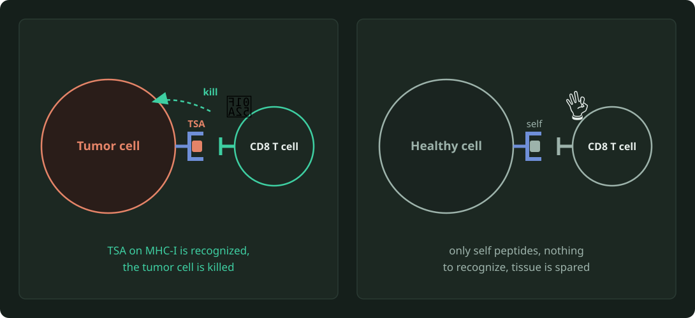{fig-align="center" width="75%"}

<small>A tumor-specific antigen (TSA) is a peptide shown on MHC-I by the tumor and by no healthy cell, so T cells aimed at it hit the tumor and leave healthy tissue alone. That makes TSAs targets for vaccines and T cell therapies.</small>

---

## Where MHC-I peptides come from

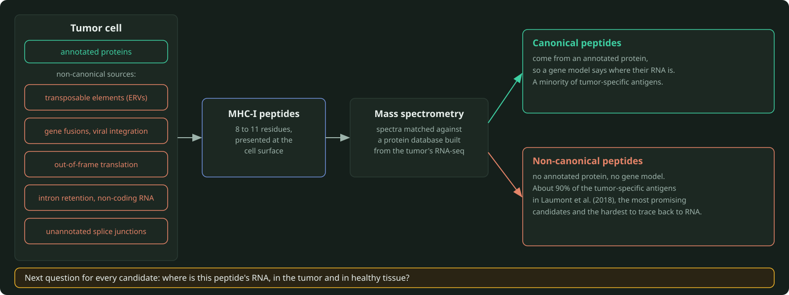{fig-align="center" width="95%"}

<small>~90% of the TSAs in @laumont2018 came from allegedly non-coding regions.</small>

---

## The question behind every TSA project

Two questions for every candidate from mass spectrometry:

| Question | Why it matters |
|---|---|
| Is it expressed in the tumor? | it has to come from the tumor's RNA |
| Is it absent from normal tissues? | toxicity risk, or T cells deleted by tolerance |

Both are answered by counting RNA-seq reads. For a new peptide, any read in any sample could be the one.

---

## How much data that is

GTEx: 2,486 healthy samples, 62.6 billion distinct 10-amino-acid fragments, 909.7 billion non-zero counts.

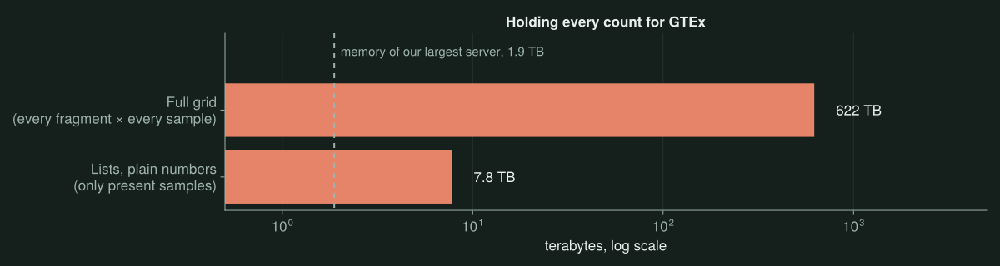{fig-align="center" width="85%"}

---

## Why it has to fit in memory

| | Disk | Memory (RAM) |
|---|---|---|
| Think of it as | the archive in the basement | your desk |
| Size on our largest server | plenty | 1.9 TB |
| Fetching one block of counts | ~17 ms | ~61 µs, about 300× faster |

A peptide query jumps around the table, so those parts have to be on the desk.

---

## What existing tools give up to fit in memory

| Tool | Keeps only | Cost |
|---|---|---|
| Gene expression tables (GTEx portal) | one number per gene | most TSAs are invisible |
| BamQuery [@ruizcuevas2023] | nothing, re-reads the BAMs where the genome places the peptide | ~730 CPU-hours per list, 199 of 550 peptides unplaced |
| REINDEER [@marchet2020] | averaged counts over stretches of fragments | 9.8% of counts exact |
| Raptor [@seiler2021] | present or absent | no counts, some false hits |

---

## Why approximate isn't safe for TSAs

| Mistake | Caused by | Cost |
|---|---|---|
| Called absent, but expressed in a healthy tissue | low counts averaged away, or the peptide never looked at | a toxicity or tolerance problem goes unseen |
| Called expressed, but absent | an averaged count or a false hit | a real TSA gets dropped |

The call is made at low counts in a few samples, exactly where approximations fail.

---

## A closer look at BamQuery

{fig-align="center" width="100%"}

---

## No compromises

::: {style="font-size: 1.35em; line-height: 1.5;"}
Keep every fragment of every sample with its exact count, and make it fit.
:::

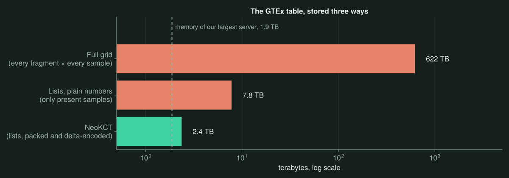{fig-align="center" width="78%"}

---

# Our approach: count once, look up forever {background-color="#1a1a2e"}

---

## Cut every read into fragments, count them all

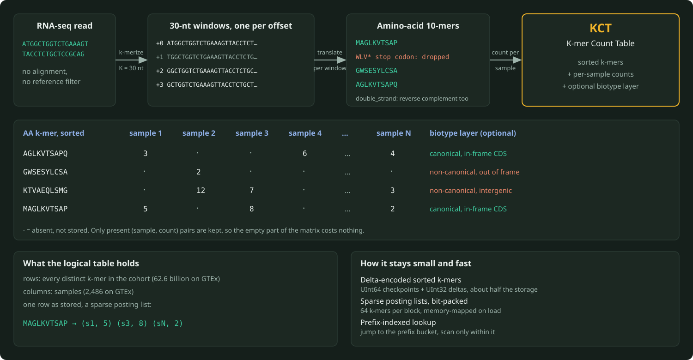{fig-align="center" width="92%"}

---

## The table, built once for GTEx

| | GTEx table |
|---|---|
| Samples | 2,486 (50 tissues) |
| Distinct 10-amino-acid fragments | 62.6 billion |
| (sample, count) entries | 909.7 billion |
| Size on disk | 2.15 TiB |
| Build | once, about 10 days on one server |
| Finding one fragment | ~25 µs |

---

# Under the hood: 155 trillion values on one server {background-color="#1a1a2e"}

---

## Store it like a search engine

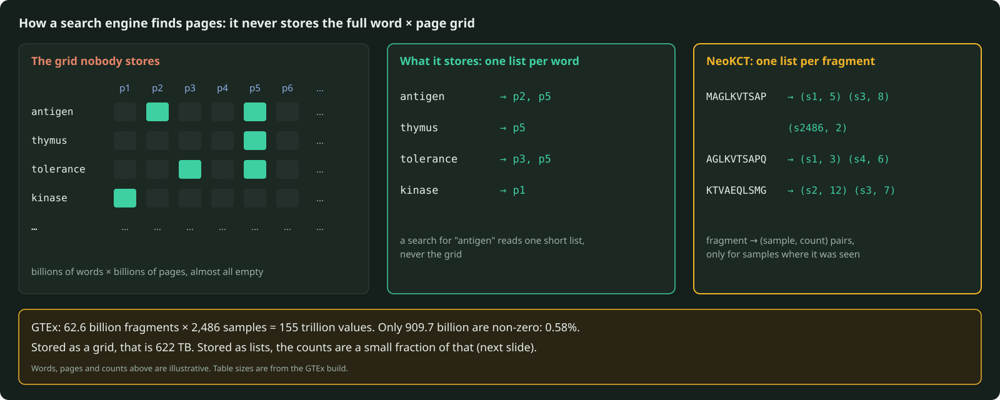{fig-align="center" width="100%"}

---

## Write down only the gaps

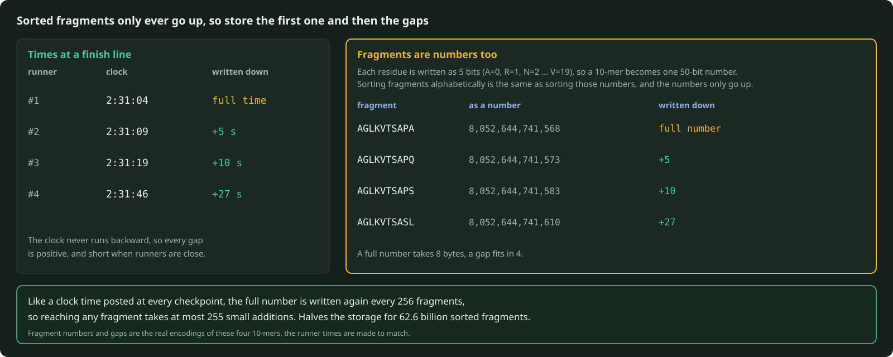{fig-align="center" width="100%"}

---

## Drop the leading zeros

{fig-align="center" width="92%"}

---

# Does it give the right answer? {background-color="#1a1a2e"}

---

## Approximate was never an option

| 200 GTEx samples, Jellyfish counts as ground truth | Exact counts returned |
|---|---|
| NeoKCT | **100%** |
| REINDEER [@marchet2020] | 9.82% |

<small>Reindeer averages its reads counts across unitigs</small>

---

## Does it agree with BamQuery?

Same 22 samples (dendritic cells and mTECs), same peptides:

:::: {.columns}
::: {.column width="45%"}
| | Result |
|---|---|
| (peptide, sample) pairs compared | 7,722 |
| Rank correlation of counts | 0.94 |
| Same call at 8.55 rphm | 340 of 351 placed peptides (97%) |
| Called differently | 11, 10 of them seen only by NeoKCT |
:::
::: {.column width="55%"}
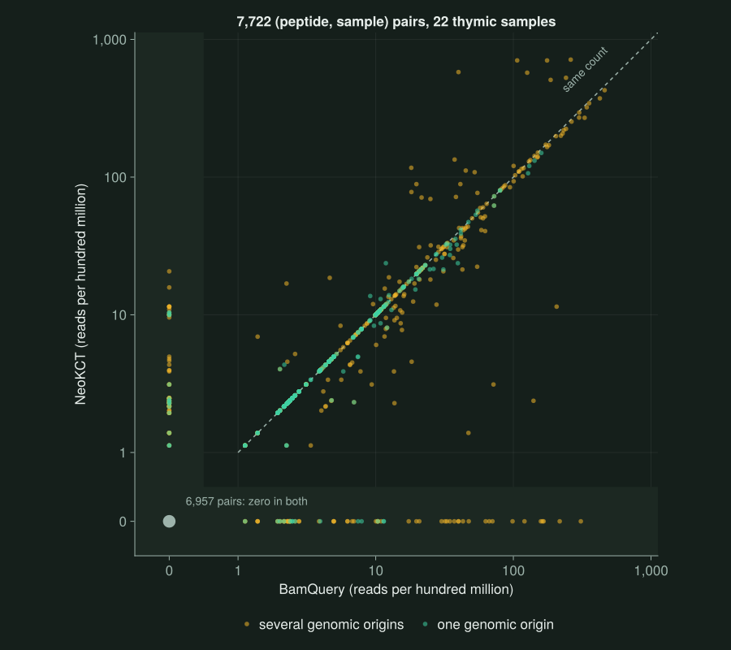{fig-align="center" width="80%"}
:::
::::

---

# What this enables {background-color="#1a1a2e"}

---

## Replacing BamQuery for expression screening

| | BamQuery | NeoKCT |
|---|---|---|
| A new peptide list against GTEx | 729.6 CPU-hours | ~46 min |
| A new threshold or tissue grouping | rerun | re-filter the same matrix |
| Peptides the genome can't place | not counted (199 of 550, 36%) | counted |
| Which locus the reads came from | exact genomic position | biotype layer: protein-coding, lncRNA, intergenic, in-frame or not |

<small>An optional locus layer, storing exact genomic positions, is also planned. The KCT structure makes this easy.</small>

---

## A tumor cohort through the same pipeline

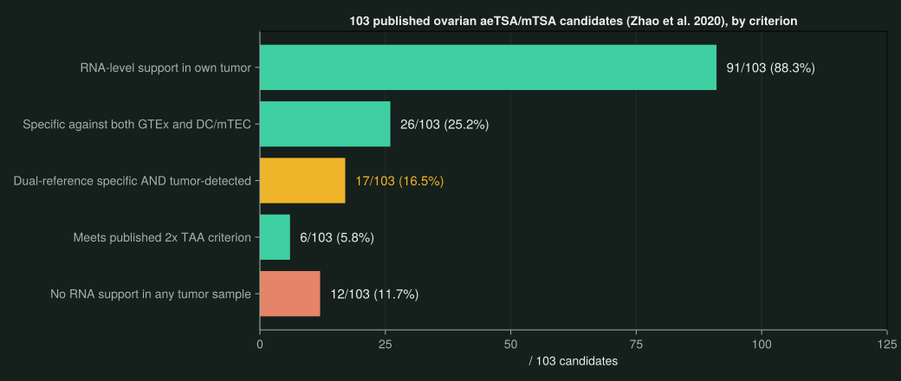{fig-align="center" width="80%"}

<small>9 ovarian tumor RNA-seq samples (GSE131880), queried with the same 103 candidates.</small>

---

## Summary

| Today | With NeoKCT |
|---|---|
| ~730 CPU-hours per peptide list | any list in under an hour |
| peptides the genome can't place go unscreened | every peptide counted |
| a new threshold means a rerun | re-filter the same matrix |
| start from MS, then check the RNA | also start from RNA: tumor fragments absent from every healthy sample |
| one healthy reference | more cohorts (TCGA, thymus), one shared table for the lab |

Manuscript being finalised for submission before the end of 2026.

---

# Questions? {background-color="#1a1a2e"}

`github.com/lemieux-lab/NeoKCT`

Thanks to Sébastien Lemieux and the Lemieux lab.

---

## References

::: {#refs}
:::

---

# Appendix {background-color="#1a1a2e"}

---

## What that costs in practice

| | Alignment-based check |
|---|---|
| One peptide list against GTEx | 729.6 CPU-hours (published) [@ruizcuevas2023] |
| Same on our server, scaled from 22 samples* | ~1,301.6 CPU-hours |
| A second list, a new threshold, a new cohort | all of it again |
| Peptides with no match in the reference genome | not counted (199 of 550) |

<small>*extrapolated from a 22-sample run, not remeasured at full scale.</small>

---

## Cost of a new question

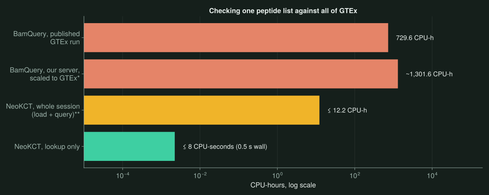{fig-align="center" width="85%"}

<small>*extrapolated from a 22-sample run. **45.6 min on 16 threads, an upper bound. NeoKCT bars converted to CPU-hours from wall-clock times.</small>

---

## Is the signal real?

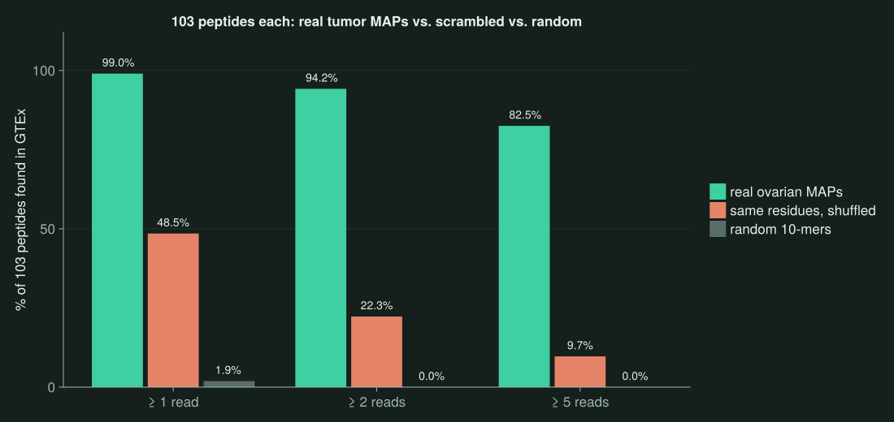{fig-align="center" width="78%"}

103 published ovarian tumor MAPs [@zhao2020] against GTEx. Shuffled peptides mostly vanish, random ones never appear.

---

## Two healthy references catch different things

The same 103 ovarian candidates against GTEx and against 22 dendritic cell + mTEC samples:

| Call | Candidates |
|---|---|
| Specific under both | 26 |
| Disqualified by both | 31 |
| Pass GTEx, expressed in mTEC or DC* | 6 |
| Pass DC/mTEC, expressed in GTEx | 40 |

<small>*thymic expression suggests the matching T cells were deleted during tolerance.</small>

---

## Where this goes next

| Direction | What it needs |
|---|---|
| Discovery before MS: tumor fragments absent from all normals | already supported, one pass comparing two tables |
| More reference cohorts (TCGA, more thymus) | a build per cohort |
| A shared table for the lab | one server-side copy |
| Paper | submission before the end of 2026 |

---

## How the table is built

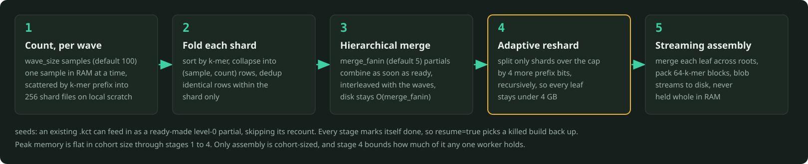{fig-align="center" width="100%"}

<small>Like sorting a 2,500-student class's exams: each TA sorts one stack of 100, stacks are merged five at a time.</small>

---

## Uneven fragments and adaptive resharding

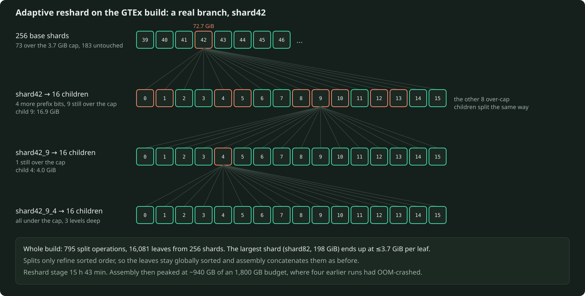{fig-align="center" width="90%"}

<small>Like a dictionary where the S volume is a hundred times thicker than X. Oversized units are split until each is under 3.7 GiB.</small>

---

## A library, not a warehouse

Catalog (265 GB index) on the desk, books (2 TiB of counts) in the basement. One trip brings back a whole shelf, and a peptide's fragments sit side by side.

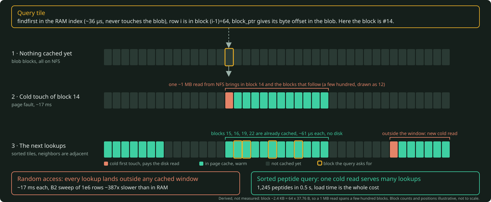{fig-align="center" width="92%"}

---

## Querying a peptide

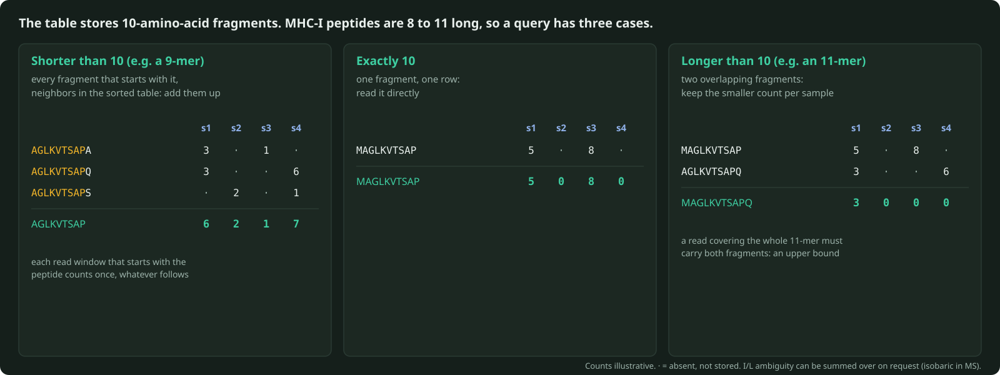{fig-align="center" width="100%"}

---

## Reads can come from either strand

{fig-align="center" width="90%"}

GTEx libraries are unstranded, so every read is counted together with its reverse complement.
